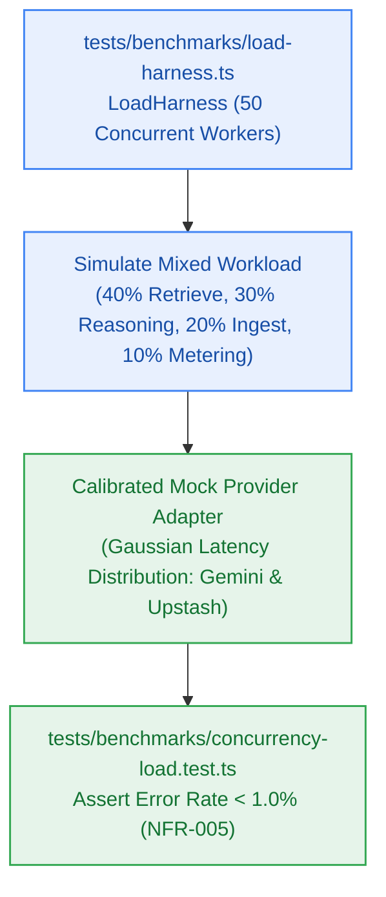

# S9.2 — 50 CCU Concurrency Stress & Load Testing Harness

> **Work Unit:** WU-M9-2 · **Effort:** 4 · **Priority:** p0 · **Risk Tier:** HIGH  
> **Owner:** `developer-agent` · **Depends on:** S9.1



## Goal
Implement a high-throughput, bounded asynchronous concurrency load harness (`LoadHarness`) simulating 50 concurrent active users (`NFR-005`) executing realistic mixed workloads across vector retrieval, multi-step reasoning, document ingestion, and credit debits with calibrated mock provider latency. Verify error rate strictly `< 1.0%` under full load.

## Acceptance Criteria
1. Implement `LoadHarness` in `tests/benchmarks/load-harness.ts` with bounded worker concurrency, streaming metrics collection, and calibrated mock provider delays.
2. Simulate realistic mixed workload:
   - 40% (20 CCU): Scoped retrieval and notebook document card resolution (`FR-033`, `FR-010`).
   - 30% (15 CCU): 6-phase grounded reasoning pipeline with streaming output (`FR-008`..`FR-011`).
   - 20% (10 CCU): Document ingestion and semantic chunking (`FR-001`..`FR-005`).
   - 10% (5 CCU): Credit balance checks and sliding rate-limiter evaluation (`FR-015`, `FR-016`).
3. Execute 50 CCU concurrent load test in `tests/benchmarks/concurrency-load.test.ts` across at least 100 iterations.
4. Verify overall error rate is strictly `< 1.0%` under maximum 50 CCU concurrent load (`NFR-005`).
5. Verify credit debit concurrency safety: account balance is never observed negative under concurrent debits (`NFR-011`).
6. Zero uncaught rejections, deadlocks, or process panics during execution.

## Change Matrix (frozen)
| Class | Paths |
|---|---|
| **new_files** | `tests/benchmarks/load-harness.ts`, `tests/benchmarks/concurrency-load.test.ts` |
| **allowed_files** | `tests/benchmarks/**` |
| **forbidden_files** | `packages/**`, `apps/**`, `infra/**`, `_documentation/**` |

## Verification Hook
```bash
bun test tests/benchmarks/concurrency-load.test.ts
```

## Rollout / Compatibility
Hardening test suite only. Operates without external cloud network dependencies; safe for offline and sandboxed execution.
