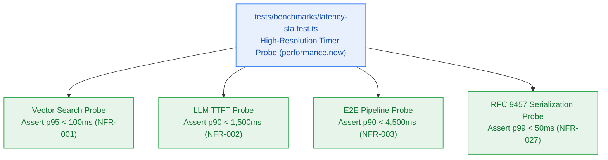

# S9.3 — Latency SLA Benchmarking & Percentile Distribution Validator

> **Work Unit:** WU-M9-3 · **Effort:** 3 · **Priority:** p0 · **Risk Tier:** MEDIUM  
> **Owner:** `developer-agent` · **Depends on:** S9.2



## Goal
Implement a high-resolution statistical latency benchmarking suite in `tests/benchmarks/latency-sla.test.ts` measuring percentile distributions (p50, p90, p95, p99) under realistic workloads. Validate that all core platform latency SLAs (`NFR-001`, `NFR-002`, `NFR-003`, `NFR-027`) meet their target thresholds.

## Acceptance Criteria
1. Implement micro-benchmark probe using `performance.now()` with 10 initial warm-up iterations discarded.
2. Vector Search Latency: assert `p95 < 100ms` on queries executed against a simulated 25,000 vector point collection (`NFR-001`).
3. LLM Time-to-First-Token: assert `p90 < 1,500ms` on streaming synthesis adapter (`NFR-002`).
4. End-to-End Reasoning Pipeline: assert `p90 < 4,500ms` for 6-phase grounded reasoning execution (`NFR-003`).
5. RFC 9457 Error Serialization: assert `p99 < 50ms` to format, validate, and sanitize Problem Details error responses (`NFR-027`).
6. Calculate percentiles accurately using rank-order array indexing across at least 100 measurement iterations.

## Change Matrix (frozen)
| Class | Paths |
|---|---|
| **new_files** | `tests/benchmarks/latency-sla.test.ts` |
| **allowed_files** | `tests/benchmarks/**` |
| **forbidden_files** | `packages/**`, `apps/**`, `infra/**`, `_documentation/**` |

## Verification Hook
```bash
bun test tests/benchmarks/latency-sla.test.ts
```

## Rollout / Compatibility
Hardening test suite only. Deterministic timer assertions execute cleanly in local and CI environments.
