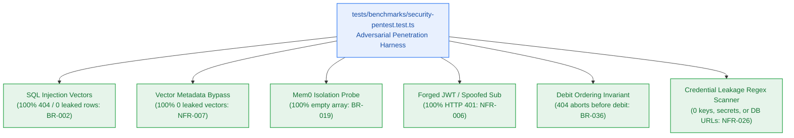

# S9.4 — Multi-Tenant Security Penetration, Cross-Tenant Isolation & Secret Scanning Suite

> **Work Unit:** WU-M9-4 · **Effort:** 4 · **Priority:** p0 · **Risk Tier:** HIGH  
> **Owner:** `developer-agent` · **Depends on:** S9.3



## Goal
Implement a rigorous adversarial security penetration test suite in `tests/benchmarks/security-pentest.test.ts` executing fuzzing attacks against relational SQL queries, Upstash Vector tenant filters, Mem0 memory stores, and Clerk JWT perimeter. Enforce Scoped Retrieval Debit Ordering (`BR-036`) and execute automated deep regex scans verifying zero credential leakage (`NFR-026`).

## Acceptance Criteria
1. Relational SQL Tenant Injection: adversarial injection strings (`' OR 1=1 --`, `'; DROP TABLE users; --`) against notebooks and threads return HTTP 404 or empty sets; zero rows from other tenants are ever returned (`NFR-007`, `BR-002`).
2. Vector Metadata Filter Bypass: vector search queries with omitted or manipulated tenant filters (`{ user_id: { $ne: null } }`) return 0 leaked points; repository layer structurally forces `user_id === authenticated_user_id` (`BR-002`, `NFR-007`).
3. Mem0 Memory Isolation: foreign user memory recall attempts strictly return empty arrays (`BR-019`, `AC-6.4`).
4. Forged RS256 JWT Authentication: crafted JWTs with invalid signatures, expired timestamps, spoofed `sub` claims, or mismatched algorithms (`alg: none`) reject with HTTP 401 Problem Details (`NFR-006`).
5. Scoped Retrieval Debit Ordering (`BR-036`, `AC-4.4`): unauthorized cross-tenant notebook probes return HTTP 404 with **zero credit debits** and **zero downstream provider invocations**.
6. Credential Leakage Scanner (`NFR-026`): automated deep regex scan across test logs, error envelopes, and sample payloads asserts 0 API keys (`AIza...`, `gsk_...`), database URLs (`postgres://...`), JWT secrets, or unredacted tokens.

## Change Matrix (frozen)
| Class | Paths |
|---|---|
| **new_files** | `tests/benchmarks/security-pentest.test.ts` |
| **allowed_files** | `tests/benchmarks/**` |
| **forbidden_files** | `packages/**`, `apps/**`, `infra/**`, `_documentation/**` |

## Verification Hook
```bash
bun test tests/benchmarks/security-pentest.test.ts
```

## Rollout / Compatibility
Hardening test suite only. Exercises authentication, metering, repository, and vector isolation boundaries without external network side-effects.
