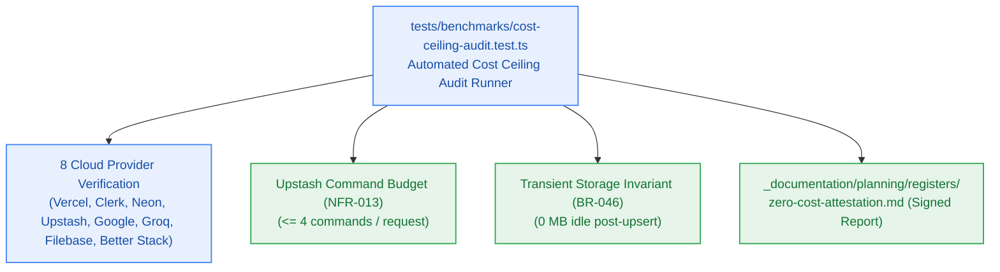

# S9.5 — Zero-Dollar Cloud Cost Ceiling Attestation & Free-Tier Quota Compliance Runner

> **Work Unit:** WU-M9-5 · **Effort:** 3 · **Priority:** p0 · **Risk Tier:** MEDIUM  
> **Owner:** `developer-agent` · **Depends on:** S9.4



## Goal
Implement a programmatic cost ceiling audit runner in `tests/benchmarks/cost-ceiling-audit.test.ts` certifying strict compliance with the $0.00/month infrastructure ceiling (`NFR-016`). Validate that all 8 cloud accounts operate on free-tier SKUs with zero stored credit cards, command budgets do not exceed 4 commands/request (`NFR-013`), transient staging maintains zero idle storage (`BR-046`), and generate the signed markdown attestation artifact.

## Acceptance Criteria
1. Validate that all 8 cloud accounts (Vercel, Clerk, Neon, Upstash, Google AI Studio, Groq, Filebase, Better Stack) adhere to free-tier SKUs, rate limits, and zero dollar billing limits (`NFR-016`).
2. Verify zero credit cards, billing profiles, or payment tokens are required or present in workspace environment configurations.
3. Verify Upstash command budget: request handlers execute strictly $\le 4$ Upstash Redis/Vector commands per HTTP request (`NFR-013`).
4. Verify transient storage zero-byte idle invariant: staged S3 binaries are deleted immediately post-upsert (`BR-046`).
5. Generate formal, signed markdown attestation artifact in `_documentation/planning/registers/zero-cost-attestation.md` documenting audit results across all 8 vendors with date, hash, and status: `CERTIFIED_ZERO_DOLLAR`.

## Change Matrix (frozen)
| Class | Paths |
|---|---|
| **new_files** | `tests/benchmarks/cost-ceiling-audit.test.ts`, `_documentation/planning/registers/zero-cost-attestation.md` |
| **allowed_files** | `tests/benchmarks/**`, `_documentation/planning/registers/zero-cost-attestation.md` |
| **forbidden_files** | `packages/**`, `apps/**`, `infra/**`, `_documentation/planning/architecture/**`, `_documentation/planning/contracts/**` |

## Verification Hook
```bash
bun test tests/benchmarks/cost-ceiling-audit.test.ts
```

## Rollout / Compatibility
Documentation and audit test runner. Produces a durable Class A governance record certifying $0.00 cloud spend.
