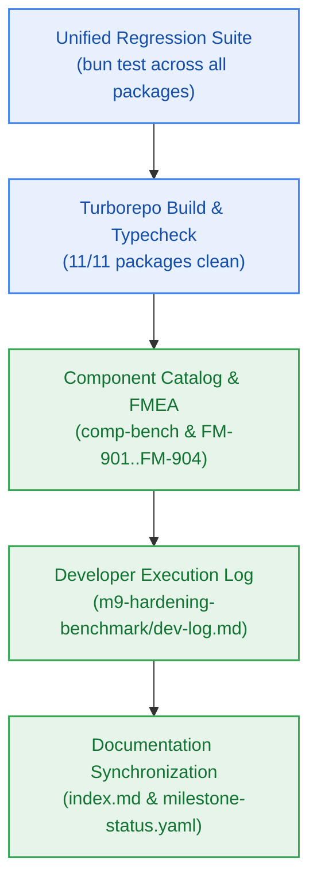

# S9.6 — Monorepo Regression Pass, RC-1 Hardening Certification & Documentation Synchronization

> **Work Unit:** WU-M9-6 · **Effort:** 3 · **Priority:** p0 · **Risk Tier:** MEDIUM  
> **Owner:** `developer-agent` · **Depends on:** S9.5



## Goal
Execute full regression testing across the entire monorepo (313 baseline tests + new benchmark and security suites), verify zero build or typecheck errors, ensure closed 17-member RFC 9457 error catalogue remains intact, register `comp-bench` in component catalog and `FM-901..FM-904` in failure mode register, author the developer execution log, and synchronize workspace documentation.

## Acceptance Criteria
1. Execute `bun test` across the full monorepo suite; assert 100% pass and 0 failures across all test files.
2. Execute `bun run build` and `bun run typecheck`; assert 11/11 packages build and typecheck cleanly with 0 TypeScript errors.
3. Verify closed 17-member RFC 9457 error catalogue test in `packages/contracts/tests/errors.test.ts` passes 5/5 with zero modifications.
4. Update `_documentation/planning/contracts/component-catalog.yaml` with `comp-bench` component and M9 hardening governance rules.
5. Update `_documentation/planning/registers/failure-mode-register.md` with FM-901..FM-904.
6. Author developer execution log in `_documentation/planning/milestones/m9-hardening-benchmark/dev-log.md` recording story-by-story evidence.
7. Synchronize `_documentation/index.md` and `_documentation/planning/milestones/milestone-status.yaml`.

## Change Matrix (frozen)
| Class | Paths |
|---|---|
| **new_files** | `_documentation/planning/milestones/m9-hardening-benchmark/dev-log.md` |
| **allowed_files** | `_documentation/planning/contracts/component-catalog.yaml`, `_documentation/planning/registers/failure-mode-register.md`, `_documentation/planning/milestones/milestone-status.yaml`, `_documentation/planning/milestones/m9-hardening-benchmark/**`, `_documentation/index.md` |
| **forbidden_files** | `packages/**`, `apps/**`, `infra/**`, `tests/**` |

## Verification Hook
```bash
bun test && bun run build && bun run typecheck
```

## Rollout / Compatibility
Documentation synchronization and release candidate hardening ratification.
