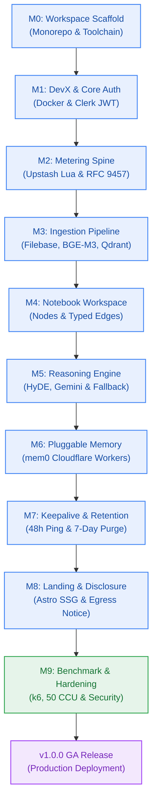
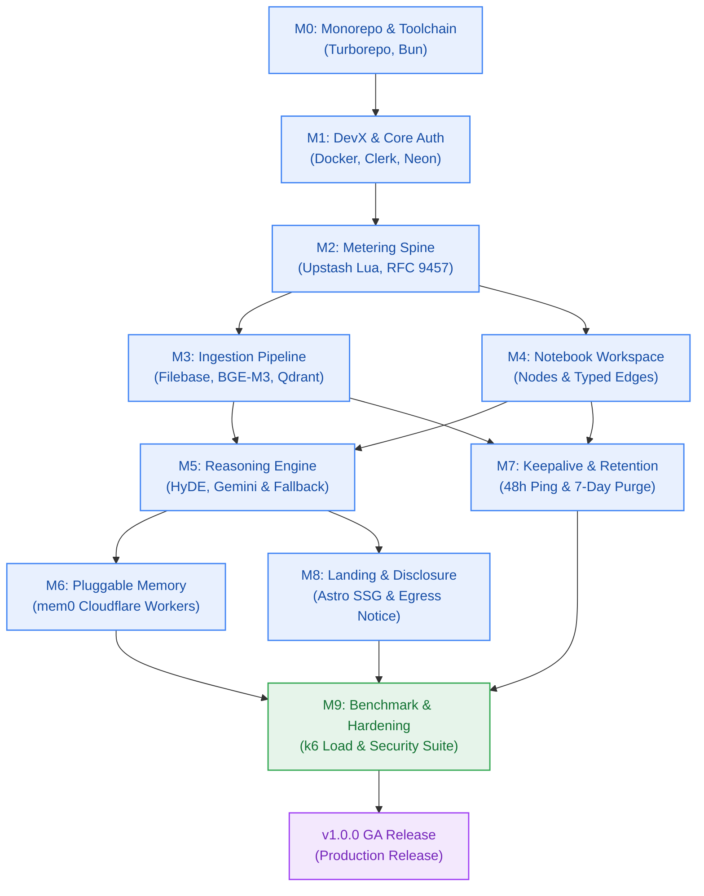
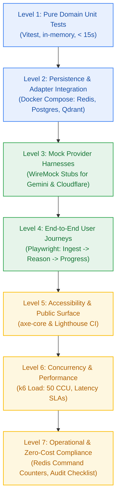
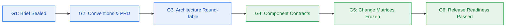

# Delivery Roadmap & Release Hierarchy: v0 to v1

> **Project:** Contextual AI Platform (`contextual`)  
> **Author:** pm-agent (Stage 2 Owner) · **Status:** Active Roadmap  
> **Lifecycle Progression:** v0.1.0 (Foundation) → v0.9.0-rc.1 (Release Candidate) → v1.0.0 (General Availability)  
> **Cost Invariant:** Strictly $0.00/Month across all phases (`NFR-016`)  

---

## 1. Release Progression: From v0 to v1

Contextual follows a structured evolutionary delivery path. Each milestone is a self-contained, demoable, and verifiable increment that builds upon verified foundational contracts.

> **Drift Reconciliation Notice (2026-10-23):**  
> Earlier planning passes erroneously assumed M0 (Workspace Scaffold) and M1 (DevX & Auth) were completed based on external reference project inferences. The current repository contains zero implementation code. M0, M1, and M2 are tracked as `not-started`. M0 is the active priority for milestone breakdown and scaffolding.

### Milestone Hierarchy & SemVer Mapping

| Milestone | Target Version | Capability Domain | Key Delivered Artifacts | Gate | Verification Focus |
|---|---|---|---|---|---|
| **M0** | `v0.1.0-alpha.1` | Workspace Scaffold | Monorepo layout, Bun toolchain, shared packages (`@repo/contracts`, `@repo/config`, `@repo/db`, `@repo/ui`) | G1 Ready | Turborepo builds cleanly; TypeScript strict check passes |
| **M1** | `v0.1.0` | DevX & Core Auth | Containerized local stack (`infra/compose.yaml`), `npm run dev:doctor`, Clerk OAuth JWT, Neon Postgres schema | Planned | `npm run dev:doctor` < 5m; 401 on unauthenticated requests |
| **M2** | `v0.2.0` | Metering Spine | Atomic Upstash Redis Lua credit ledger (10 daily credits), sliding window rate limiter (5 RPS), RFC 9457 error catalogue | Planned | 100 concurrent debit races without negative balance; HTTP 402 short-circuit |
| **M3** | `v0.3.0` | Ingestion Pipeline | Filebase S3 transient staging, PDF / YouTube / Web parsers, Cloudflare BGE-M3 embeddings, Qdrant indexing, live SSE stream (cap 280s), immediate post-ingest binary deletion | Planned | 35-page text PDF at > 5 pages/sec; staging bytes deleted post-upsert |
| **M4** | `v0.4.0` | Notebook Workspace | Hierarchical notebook nodes, typed relations (`cites` and `related`), document-backed cards (< 10ms resolution), scoped retrieval security | Planned | Zero cross-tenant node visibility; invalid edge rejected with HTTP 400 |
| **M5** | `v0.5.0` | Reasoning Engine | Query decomposition (2–5 sub-questions), HyDE hypothetical passages, Top-3 vector retrieval per question, Gemini Flash primary synthesis, Cloudflare Llama-3.1 fallback, inline citations | Planned | Synthesized claims backed 100% by citations; transparent fallback on Gemini 429 |
| **M6** | `v0.6.0` | Pluggable Memory | `MemoryStore` interface, self-hosted mem0 on Cloudflare Workers, extraction seam for standalone worker execution | Planned | Long-term memory query latency < 150ms; zero external vendor memory fees |
| **M7** | `v0.7.0` | Maintenance & Observability | Upstash QStash crons, 7-day retention cascade sweeper, 30-day tombstones (HTTP 410), OTel export to Better Stack | Completed (G6 PASS) | QStash webhook invokes reset; idle data purged; 410 tombstone; secret redaction |
| **M8** | `v0.8.0` | Public Landing & Privacy | Public Astro/Next landing page, WCAG 2.1 AA accessibility, prominent dynamic AI provider training data disclosure banner (`P-030`, `CV-041`) | Planned | Lighthouse Performance ≥ 90; axe-core 0 violations; disclosure rendered on all prompt views |
| **M9** | `v0.9.0-rc.1` | Hardening & Benchmarks | Automated k6/autocannon performance suite (50 CCU), multi-tenant penetration testing, $0.00/month cloud bill audit | Planned | p95 vector search < 100ms; p90 e2e pipeline < 4.5s; zero credit card on file |
| **GA** | `v1.0.0` | Production Release | Release tag `v1.0.0`, verified CI/CD pipeline, production smoke verification, changelog, migration guide | Planned | Final Checkpoint 5 closeout; production system live on Vercel Hobby + free tiers |

---

## 2. Release Dependency Graph

---

## 3. Comprehensive Testing Strategy for Release

Testing is woven into every milestone rather than deferred to the end. The platform uses a 7-level verification pyramid ensuring zero regressions across all functional and non-functional baselines:

### 3.1 Level 1: Pure Domain Unit Tests (Vitest)
- **Scope:** In-memory business logic: RFC 9457 error serialization, Zod schema validation, query decomposition heuristic, inline citation parser, credit calculation math.
- **SLA:** Complete suite executes in < 15 seconds.
- **Criteria:** 100% branch coverage on core domain invariant functions (`BR-001`..`BR-048`).

### 3.2 Level 2: Persistence & Local Adapter Contracts (Docker)
- **Scope:** Verify Kysely queries against Neon Postgres, Lua scripts against Redis, and payload filtering against local Qdrant.
- **Execution:** Runs against containerized services orchestrated by `infra/compose.yaml`.
- **Criteria:** Multi-threaded concurrency testing validates that credit balances never dip below zero (`NFR-011`) and rate limiter strictly throttles at 5 RPS (`NFR-012`).

### 3.3 Level 3: Upstream Provider Mock & Resilience Harnesses
- **Scope:** Verify error classification, retry backoff, and fallback switching without hitting live cloud provider rate limits or consuming daily free quotas.
- **Execution:** WireMock stubs simulate:
  - Google AI Studio HTTP 429 `RESOURCE_EXHAUSTED` → asserts immediate failover to Cloudflare Workers AI (`NFR-022`, `D-01`).
  - BullMQ network disconnection → asserts exponential retry (initial 2s, 3 max) before refunding debited credits (`BR-005`, `BR-033`).
  - Corrupt or encrypted PDFs → asserts machine-readable error reasons (`PASSWORD_PROTECTED`, `NO_TEXT_LAYER`) returned with zero debited credits (`BR-045`).

### 3.4 Level 4: End-to-End User Journey Tests (Playwright)
- **Scope:** Full-stack user flows in headless browser:
  1. Authenticate via Clerk mock session.
  2. Create notebook and upload 5MB test PDF.
  3. Validate real-time SSE progress events (0% → 100%) and reconnect recovery via `Last-Event-ID`.
  4. Submit multi-faceted question; verify decomposition, HyDE generation, and streamed answer with clickable citation anchors.
  5. Verify Filebase staging file is deleted immediately post-ingest.

### 3.5 Level 5: Accessibility & Public Surface Testing (axe-core)
- **Scope:** Public marketing landing page (`apps/landing`) and dynamic AI provider disclosure modals (`CV-041`).
- **Criteria:**
  - Automated `axe-core` scan reports 0 critical or serious WCAG 2.1 AA violations.
  - Google Lighthouse Performance score ≥ 90, LCP < 2.0s on simulated 4G connection (`NFR-018`).
  - Disclosure banner focusable and visible on all screen sizes.

### 3.6 Level 6: Performance, Concurrency & Load Testing (k6)
- **Scope:** Simulated multi-user saturation testing (`NFR-005`).
- **Scenarios:**
  - 50 concurrent virtual users executing mixed search, ingestion, and reasoning queries.
  - Latency SLA verification:
    - Vector search p95 < 100 ms (`NFR-001`).
    - LLM Time-to-First-Token p90 < 1,500 ms (`NFR-002`).
    - E2E reasoning pipeline p90 < 4,500 ms (`NFR-003`).
  - Error rate under maximum load must remain strictly < 1.0%.

### 3.7 Level 7: Operational & Zero-Cost Compliance Audit
- **Scope:** Non-functional infrastructure verification before v1.0.0 release.
- **Checks:**
  - **Redis Command Overhead:** Command audit confirms ≤ 4 Redis operations per user action, ensuring monthly usage stays < 50,000 commands (< 10% of Upstash 500k limit) (`NFR-013`).
  - **Transient Filebase Storage:** Bucket storage confirmed at 0 MB when workers are idle (`BR-046`).
  - **Autonomous Keepalive Probe:** Simulated 48-hour cron touch verifies Qdrant collection probe executes and keeps cluster active (`NFR-017`, `BR-043`).
  - **Retention Cascade:** Idle notebook (≥ 7 days) correctly purged with vector points removed and tombstone row returning HTTP 410 (`BR-037`, `BR-044`).
  - **Zero Cost Ceiling Audit:** 100% of vendor dashboards (Google AI Studio, Cloudflare, Qdrant, Filebase, Upstash, Neon, Clerk, Better Stack) confirmed on free tier with **zero credit cards on file** (`NFR-016`).

---

## 4. Quality Gates & Release Exit Criteria

Progress between milestones and the final v1.0.0 release is governed by the 6 DBW Quality Gates:

- **Gate G1 (Requirements Sealed):** Handled by `analyst-agent`. Complete FR/NFR, testable business rules, and §12 Domain Glossary certified. (PASSED).
- **Gate G2 (Conventions & Roadmap):** Handled by `pm-agent`. Canonical `conventions.md`, `prd.md`, release hierarchy, and milestone trackers certified. (PASSED).
- **Gate G3 (Strategic Alignment):** Phase 3 Party-Mode alignment between PM, Architect, and Specialists. Scalability, failure modes, and technical debt bounded.
- **Gate G4 (Architecture & Contracts):** C4 models, OpenAPI 3.1 specifications, typed config schemas, and component boundaries frozen by `architect-agent`.
- **Gate G5 (Implementation Planning):** Milestone broken into atomic stories with frozen Change Matrices (`new_files`, `allowed_files`, `forbidden_files`) and verification scenarios by `sprint-agent`.
- **Gate G6 (Verification & Release Readiness):** Clean automated test execution, zero lint errors, test evidence verified by `test-agent`, and signed release tag pushed by `deployment-agent`.

---

## 5. Production v1.0.0 GA Release Readiness Checklist

Before the annotated tag `v1.0.0` is cut and pushed by `deployment-agent`, all 10 conditions must be attested:
1. [ ] **Functional Completeness:** All 42 Functional Requirements (FR-001 through FR-042) implemented and passing automated tests.
2. [ ] **Performance SLAs:** Latency baselines (NFR-001..NFR-003) satisfied under 50 CCU load testing.
3. [ ] **Security & Isolation:** 100% of protected routes reject invalid JWT; zero cross-tenant leakage in vector and relational queries.
4. [ ] **Zero Cost Invariant:** Attestation of $0.00/month infrastructure spend with zero payment cards registered across all 8 vendors.
5. [ ] **Data Governance Disclosure:** Un-dismissible dynamic AI provider training disclosure banner certified on all prompt views (`FR-030`).
6. [ ] **RFC 9457 Error Integrity:** All API error payloads conform to the closed 17-member problem details catalogue.
7. [ ] **Autonomous Hygiene:** 48-hour Qdrant keepalive probe and 7-day retention cascade tested and running on cron schedules.
8. [ ] **Monorepo Build Health:** `bun run build` and `npm run dev:doctor` run clean on fresh clone in < 5 minutes.
9. [ ] **Documentation Sync:** All Class A canonical documents (`prd.md`, `conventions.md`, `architecture.md`, `verification.md`) synchronized with active code.
10. [ ] **Release Artifacts:** Curated `CHANGELOG.md` entry authored, migration guide verified, and release notes approved by PM Agent.

---
*Authored and governed by pm-agent at Checkpoint 2 (Gate G2).*
