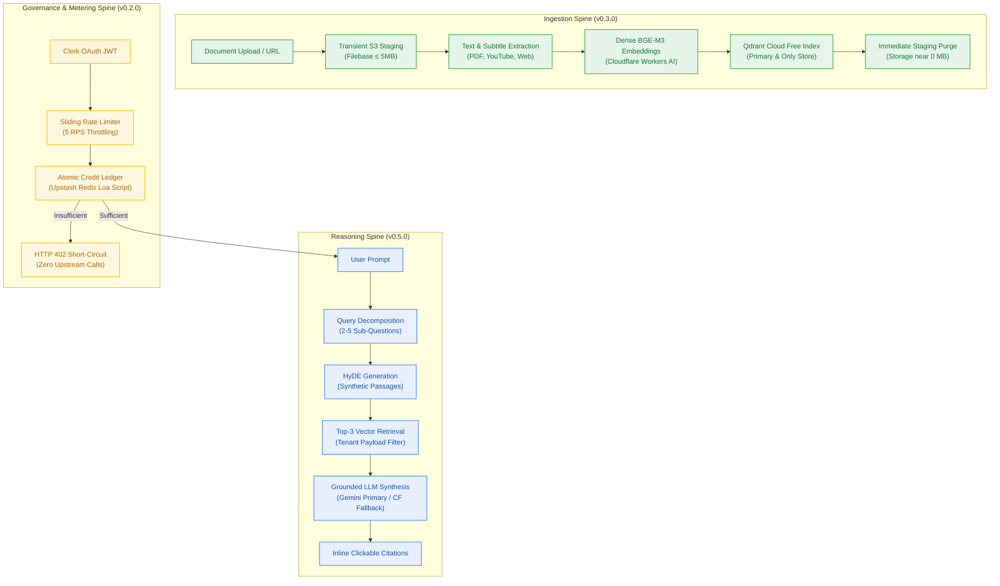

# Product Requirements Document (PRD) — Contextual AI Platform

> **Status:** Approved (Pending Implementation)  
> **Author:** pm-agent (Stage 2 Owner) · **Date:** 2026-10-23  
> **Grounding:** `_documentation/planning/project-brief.md` (FR-001..FR-042, NFR-001..NFR-032, BR-001..BR-048), `memo-001-contextual-standards-and-free-tier-research.md`, ADR-0001..ADR-0003  
> **Release Scope:** v0.1.0 (Foundation) to v1.0.0 (Production General Availability)  

---

## 1. Overview

Contextual is an enterprise-grade conversational knowledge retrieval platform that ingests heterogeneous documents (academic PDFs, YouTube lecture transcripts, and web articles) into personal notebook workspaces and executes a 6-phase grounded reasoning pipeline with query decomposition, hypothetical document embeddings (HyDE), and multi-vector retrieval.

Operating under a strict $0.00/month infrastructure ceiling (`NFR-016`), the platform delivers multi-tenant research capabilities by orchestrating coordinated cloud free-tier services (Google Gemini, Cloudflare Workers AI, Qdrant Cloud Free, Filebase S3, Upstash Redis, Neon Postgres, and Clerk Auth) guarded by atomic Redis Lua metering, transient binary staging, and automated retention cascades.

---

## 2. Problem

Knowledge workers, software developers, researchers, and students struggle with fragmented information scattered across disconnected formats. Existing RAG and chat-with-PDF tools suffer from three systemic flaws:
1. **Shallow Semantic Search:** Naive single-query vector retrieval fails on complex analytical questions that require synthesis across multiple document sections or disparate sources.
2. **Infrastructure Bloat & Vendor Lock-In:** Traditional retrieval platforms demand expensive, always-on server clusters, specialized vector database fees, and recurring credit card subscriptions that prevent open experimentation.
3. **Data Privacy & Governance Gaps:** Commercial AI services ingest user prompts and proprietary research into model training pipelines without prominent, honest frontend disclosure of data egress boundaries.

---

## 3. Goals

| # | Goal | Measure |
|---|---|---|
| **G-1** | Zero-Dollar Operational Ceiling | Strictly $0.00/month cloud spend across all vendors; zero payment cards stored (`NFR-016`). |
| **G-2** | Deep Multi-Step Synthesis | Complex queries decompose into 2–5 sub-questions with HyDE summaries, retrieving top-3 vectors per question (`FR-008`–`FR-011`). |
| **G-3** | Grounded Inline Citations | 100% of synthesized claims trace directly to retrieved document chunks; zero hallucinations outside context (`BR-009`). |
| **G-4** | Heterogeneous Media Ingestion | Ingest text PDFs (≤ 5MB), YouTube video transcripts, and web documentation with live SSE progress (`FR-004`–`FR-006`, `FR-035`). |
| **G-5** | Atomic Quota & Credit Protection | Balance never observed negative under concurrent debits (`NFR-011`); 5 RPS rate limiter (`FR-017`); HTTP 402 short-circuit before LLM invocation (`BR-015`). |
| **G-6** | Multi-Tenant Data Isolation | 100% of SQL queries and Qdrant vector lookups enforce tenant boundaries; zero cross-tenant data leakage (`NFR-007`, `BR-002`). |
| **G-7** | Transparent AI Data Governance | Prominently disclose prompt data routing to Google AI Studio under model training terms on all public and authenticated surfaces (`FR-030`, `CV-041`). |
| **G-8** | Developer Bootstrap Speed | Complete local developer environment boots from clean clone in < 5 minutes via `npm run dev:doctor` (`FR-012`, `NFR-010`). |

---

## 4. Non-Goals

- ❌ **Commercial Subscriptions & Credit Card Processing:** Out of scope for v1.0.0. Storing payment methods or accepting paid transactions violates the $0.00/month infrastructure ceiling and Vercel Hobby Terms of Service.
- ❌ **Point-in-Time Recovery & Cross-Region Disaster Backups:** High-availability replication and PITR for free-tier storage (Qdrant Cloud Free, Filebase) are explicitly excluded (`BR-048`). Data loss on external free tiers is treated as permanent.
- ❌ **Synchronous HTTP Ingestion of Large Files:** Documents will never be parsed or embedded synchronously within the client HTTP request cycle due to serverless execution ceilings (10s/300s). All parsing runs via asynchronous worker jobs.
- ❌ **Credit Carry-Over & Quota Banking:** Unspent daily credits permanently expire at `CREDIT_RESET_TZ` (08:00 UTC) with no rollover (`BR-024`, `BR-025`) to protect daily provider rate headroom.
- ❌ **Arbitrary Complex Knowledge Graph Ontologies:** Inter-node relationships in notebook workspaces are strictly restricted to `cites` and `related` (`FR-032`). User-defined graph ontology schemas are deferred post-v1.
- ❌ **Client-Side Parsing of Error Prose:** Frontend clients must never parse human-readable error strings; all branching must rely on the immutable RFC 9457 `type` URI (`BR-032`).

---

## 5. Functional Requirements (FR) to Epic Mapping

The 42 functional requirements sealed in `project-brief.md` are mapped across 9 delivery epics spanning the v0.1.0 to v1.0.0 release roadmap:

| ID | Functional Requirement | Source Trace | Target Milestone | Target Epic |
|---|---|---|---|---|
| **FR-001** | Social OAuth Authentication (Clerk Google/GitHub) | User Directive | M1 (v0.1.0) | `EPIC-001: Workspace Foundation` |
| **FR-002** | Conversation Thread & Message Persistence in Neon | User Directive | M1 (v0.1.0) | `EPIC-001: Workspace Foundation` |
| **FR-003** | Multi-Tenant Session & Payload Isolation | BR-002 | M1 (v0.1.0) | `EPIC-001: Workspace Foundation` |
| **FR-012** | Local Developer Setup (`infra/compose.yaml`, dev:doctor) | PTY-003 / Devprod | M0 (v0.1.0) | `EPIC-001: Workspace Foundation` |
| **FR-021** | Turborepo Monorepo Layout (`apps/*`, `packages/*`) | CV-023 | M0 (v0.1.0) | `EPIC-001: Workspace Foundation` |
| **FR-014** | Credit Grant Allocation (10 credits/day default) | A-08, A-10 | M2 (v0.2.0) | `EPIC-002: Metering & Rate Limiting` |
| **FR-015** | Metered Action Debit via Single Redis Lua Script | BR-014 / PTY-010 | M2 (v0.2.0) | `EPIC-002: Metering & Rate Limiting` |
| **FR-016** | Credit Exhaustion Short-Circuit (HTTP 402) | BR-015 / A-02 | M2 (v0.2.0) | `EPIC-002: Metering & Rate Limiting` |
| **FR-017** | Per-User Sliding Rate Limiter (5 RPS, HTTP 429) | BR-016 / PTY-010 | M2 (v0.2.0) | `EPIC-002: Metering & Rate Limiting` |
| **FR-018** | Upstash Redis Shared State Layer (Atomic Scripts) | BR-014 / D-07 | M2 (v0.2.0) | `EPIC-002: Metering & Rate Limiting` |
| **FR-024** | Idempotent Daily Credit Reset at 08:00 UTC | BR-025 / A-09 | M2 (v0.2.0) | `EPIC-002: Metering & Rate Limiting` |
| **FR-025** | RFC 9457 Structured Problem Error Envelope | BR-028..032 | M2 (v0.2.0) | `EPIC-002: Metering & Rate Limiting` |
| **FR-026** | Service Limit Reporting (`<quota_period>`, `<service>`) | A-16 / BR-029 | M2 (v0.2.0) | `EPIC-002: Metering & Rate Limiting` |
| **FR-027** | Closed 17-Member Error Type Catalogue | CV-017 | M2 (v0.2.0) | `EPIC-002: Metering & Rate Limiting` |
| **FR-028** | Upstream Provider Quota Classification | PTY-010 | M2 (v0.2.0) | `EPIC-002: Metering & Rate Limiting` |
| **FR-029** | Quota State Surfaced in HTTP Headers & Payloads | PTY-010 | M2 (v0.2.0) | `EPIC-002: Metering & Rate Limiting` |
| **FR-004** | Asynchronous PDF Document Parsing (≤ 5MB) | Intake / ADR-0003 | M3 (v0.3.0) | `EPIC-003: Ingestion Pipeline` |
| **FR-005** | YouTube Subtitle Extraction with Timestamps | Intake | M3 (v0.3.0) | `EPIC-003: Ingestion Pipeline` |
| **FR-006** | Website Crawling & Markdown Conversion | Intake | M3 (v0.3.0) | `EPIC-003: Ingestion Pipeline` |
| **FR-007** | Vector DB Population (Cloudflare BGE-M3 + Qdrant) | Intake / ADR-0001 | M3 (v0.3.0) | `EPIC-003: Ingestion Pipeline` |
| **FR-035** | Live Progress Stream via SSE (Cap at 280s) | BR-034 / D-16 | M3 (v0.3.0) | `EPIC-003: Ingestion Pipeline` |
| **FR-036** | Deterministic Progress Reporting (Real denominators) | BR-036 / UX | M3 (v0.3.0) | `EPIC-003: Ingestion Pipeline` |
| **FR-037** | Ingestion Terminal Failure Credit Refund Integrity | BR-033 | M3 (v0.3.0) | `EPIC-003: Ingestion Pipeline` |
| **FR-038** | Structured Ingestion Failure Reasons (Closed Union) | Contracts | M3 (v0.3.0) | `EPIC-003: Ingestion Pipeline` |
| **FR-040** | Non-Debiting Retry for Failed Ingestion Jobs | BR-033 | M3 (v0.3.0) | `EPIC-003: Ingestion Pipeline` |
| **FR-031** | Notebook and Hierarchical Node Workspace | Intake / M4 | M4 (v0.4.0) | `EPIC-004: Notebook Workspace Graph` |
| **FR-032** | Typed Node Relations (`cites` and `related` only) | Intake / Architecture | M4 (v0.4.0) | `EPIC-004: Notebook Workspace Graph` |
| **FR-033** | Document-Backed Nodes (< 10ms resolution) | Ingestion | M4 (v0.4.0) | `EPIC-004: Notebook Workspace Graph` |
| **FR-034** | Scoped Cross-Note Retrieval with Ownership Check | BR-036 | M4 (v0.4.0) | `EPIC-004: Notebook Workspace Graph` |
| **FR-008** | Query Decomposition into 2–5 Sub-Questions | D-03 / Party-Mode | M5 (v0.5.0) | `EPIC-005: Grounded Reasoning Engine`|
| **FR-009** | HyDE Synthetic Passage Generation per Sub-Question | D-03 / Party-Mode | M5 (v0.5.0) | `EPIC-005: Grounded Reasoning Engine`|
| **FR-010** | Multi-Vector Top-3 Retrieval with Tenant Filter | BR-008 / D-03 | M5 (v0.5.0) | `EPIC-005: Grounded Reasoning Engine`|
| **FR-011** | Grounded Synthesis with Gemini Primary & CF Fallback| BR-009 / Intake | M5 (v0.5.0) | `EPIC-005: Grounded Reasoning Engine`|
| **FR-039** | Unavailable Sources Explicitly Named in Answer Footer| UX / Synthesis | M5 (v0.5.0) | `EPIC-005: Grounded Reasoning Engine`|
| **FR-019** | Pluggable `MemoryStore` Interface (mem0 self-hosted) | BR-018 / A-06 | M6 (v0.6.0) | `EPIC-006: Pluggable Memory Store` |
| **FR-020** | Modular Monolith & Extraction Seam Architecture | D-09 / Architecture | M6 (v0.6.0) | `EPIC-006: Pluggable Memory Store` |
| **FR-041** | Scheduled Maintenance Crons with Heartbeat Monitoring | BR-041 / Infra | M7 (v0.7.0) | `EPIC-007: Maintenance & Keepalive` |
| **FR-042** | 7-Day Retention Cascade Deletion & 30-Day Tombstones | ADR-0001 / BR-037 | M7 (v0.7.0) | `EPIC-007: Maintenance & Keepalive` |
| **FR-023** | Metering Telemetry & OTel Events to Better Stack | NFR-009 / BR-010 | M7 (v0.7.0) | `EPIC-007: Maintenance & Keepalive` |
| **FR-022** | Public Marketing Landing Page (SEO Indexable) | BR-024 / UX | M8 (v0.8.0) | `EPIC-008: Landing & Egress UI` |
| **FR-030** | Dynamic AI Provider Data Training Disclosure Banner | Q-002 / CV-041 | M8 (v0.8.0) | `EPIC-008: Landing & Egress UI` |
| **FR-013** | Automated Benchmark Suite (k6 / autocannon load tests)| NFR-005 / QA | M9 (v0.9.0) | `EPIC-009: Benchmark & GA Release` |

---

## 6. Non-Functional Requirements (NFR) Baseline

| ID | Category | Target Threshold | Verification Method |
|---|---|---|---|
| **NFR-001** | Performance | Vector Search Latency: p95 < 100 ms for top-3 query on ≤ 25k points | k6 load test script against Qdrant free cluster |
| **NFR-002** | Performance | LLM Time-to-First-Token: p90 < 1,500 ms for streaming responses | Automated latency probe via Gemini Flash adapter |
| **NFR-003** | Performance | E2E Reasoning Pipeline Latency: p90 < 4,500 ms for 6-phase reasoning | Synthetic integration test scenario |
| **NFR-004** | Performance | Ingestion Throughput: > 5 pages/sec for text PDF; < 30s for 1-hr YouTube | Ingestion worker benchmark test |
| **NFR-005** | Performance | Concurrency: ≥ 50 concurrent active users with < 1% error rate on mock | k6 multi-user scenario against local compose |
| **NFR-006** | Security | Auth Verification: 100% of protected endpoints reject invalid JWT with 401 | Vitest API security regression test |
| **NFR-007** | Security | Tenant Data Isolation: Zero cross-tenant data leakage in SQL and Qdrant | Automated cross-tenant penetration test suite |
| **NFR-008** | Reliability | Worker Retries: Exponential backoff (initial 2s, max 3 attempts) | BullMQ worker fault injection test |
| **NFR-009** | Observability | Structured Telemetry: 100% HTTP requests & jobs emit JSON logs with trace ID | OpenTelemetry log sink verification |
| **NFR-010** | DevX | Developer Bootstrap: Clean clone to healthy stack in < 5m (`dev:doctor`) | CI clean runner timing audit |
| **NFR-011** | Metering | Debit Concurrency Safety: Balance never observed negative | Multi-threaded concurrent debit load test |
| **NFR-012** | Rate Limiting | Decision Latency: Limiter evaluation p99 < 10 ms; strictly ≤ 5 req/sec | Sliding window load probe |
| **NFR-013** | Resource | Upstash Command Budget: ≤ 4 commands/request; ≤ 500,000 commands/month | Redis command monitor counter |
| **NFR-014** | Capacity | Memory Vendor Independence: Self-hosted mem0 on Cloudflare; $0/mo fee | Memory adapter integration audit |
| **NFR-015** | Capacity | Daily LLM Headroom: Operations sized within CF 10k neurons & Gemini RPD | Daily usage telemetry calculator |
| **NFR-016** | Cost Ceiling | **Strictly $0.00/month infrastructure spend.** Zero credit cards stored | Formal cloud account audit checklist |
| **NFR-017** | Durability | Idle Suspension Policy: Cluster keepalive probe every 48 hours | Scheduled cron heartbeat verification |
| **NFR-018** | Frontend | Landing Performance: Google Lighthouse score ≥ 90; LCP < 2.0s on 4G | Headless Lighthouse CI run |
| **NFR-019** | Architecture| Adapter Portability: Ingestion/memory extractable with zero caller changes | In-process vs out-of-process unit tests |
| **NFR-020** | Metering | Quota Period Alignment: Daily-reset credits back daily provider quotas | Multi-day simulation test |
| **NFR-021** | Headroom | Target DAU Sizing: System architecture supports ≥ 10 DAU consuming full grant| Capacity headroom verification |
| **NFR-022** | Resilience | Fallback Switching: Gemini exhaustion fails over transparently to CF AI | WireMock 429 fault injection test |
| **NFR-023** | Correctness | Idempotent Daily Reset: Reset runs exactly once per day per user | Race condition test on 08:00 UTC boundary |
| **NFR-024** | Expiration | Zero Credit Carry-Over: Balance after reset equals default grant (10) | State verification after daily rollover |
| **NFR-025** | Error Safety| Error Code Exclusivity: Zero `SERVICE_LIMIT_REACHED` for non-quota errors | Error mapping unit tests |
| **NFR-026** | Security | Zero Credential Leakage: Zero keys, DB URLs, or stack traces in logs/APIs | Automated log and response regex scanner |
| **NFR-027** | Error Safety| Error Serialization Latency: p99 < 50 ms to format RFC 9457 payload | Benchmark micro-test |
| **NFR-028** | Stability | URI Immutability: Error `type` URIs remain strictly immutable | API contract linting gate |
| **NFR-029** | Contract | Machine-Readable Quota: Quota errors expose provider, period, and resets | JSON schema validation test |
| **NFR-030** | Fidelity | Truthful Quota Periods: Reported period matches provider's real reset | Provider adapter unit tests |
| **NFR-031** | Governance | Maintenance Liveness: Crons emit heartbeats; alert if missed in 2 × cadence | Cron monitor test harness |
| **NFR-032** | Efficiency | Cascade Footprint: Weekly cascade consumes zero credits, ≤ 1% embeddings | Cascade execution cost profile |

---

## 7. Success Criteria

1. **v0.1.0 Milestone Success:** Clean monorepo repository boots in < 5 minutes via `npm run dev:doctor`; Clerk authentication protects private routes; Neon Postgres tables initialized.
2. **v0.2.0 Milestone Success:** Redis Lua debit script passes 100 concurrent debit race tests with zero lost updates and zero negative balances; rate limiter throttles 6th RPS with RFC 9457 HTTP 429; insufficient credits return HTTP 402 without hitting LLM.
3. **v0.3.0 Milestone Success:** 35-page PDF parses at > 5 pages/sec; YouTube transcript extracts accurately; BGE-M3 dense embeddings populate Qdrant; Filebase staging object deleted immediately upon upsert; live SSE progress stream connects and replays missed events.
4. **v0.4.0 Milestone Success:** Users create and organize notebooks and nodes with `cites` and `related` edges; document-backed nodes resolve in < 10ms; scoped retrieval executes only on authorized nodes.
5. **v0.5.0 Milestone Success:** Complex multi-faceted query generates 2–5 sub-questions, HyDE summaries, and top-3 chunks per sub-question; Gemini streams grounded synthesis with inline citations; transparent failover to Cloudflare Llama-3.1 on Gemini 429.
6. **v0.6.0 Milestone Success:** Memory operations route exclusively through `MemoryStore` interface with self-hosted mem0 running on Cloudflare Workers; zero external vendor memory charges.
7. **v0.7.0 Milestone Success:** Qdrant keepalive probe pings every 48 hours preventing cluster suspension; weekly retention cascade purges inactive notebooks (≥ 7 days) and leaves 30-day tombstones returning HTTP 410.
8. **v0.8.0 Milestone Success:** Public marketing page achieves Lighthouse score ≥ 90 and passes `axe-core` accessibility scans with 0 violations; AI training disclosure banner displays prominently on all prompt input views.
9. **v0.9.0 Benchmark & Hardening Success:** k6 load test sustains 50 concurrent virtual users at < 1% error rate; vector search p95 < 100ms; E2E reasoning pipeline p90 < 4.5s; all 6 DBW quality gates pass.
10. **v1.0.0 Production GA Success:** Complete test suite passes in CI; release tag `v1.0.0` signed and pushed; zero cost incurred on all free-tier accounts ($0.00 spend verified).

---

## 8. Risks & Mitigations

| Risk | Severity | Mitigation Strategy |
|---|---|---|
| **Google Gemini Free-Tier Data Training** | High | Mandate dynamic frontend egress disclosure (`FR-030`, `CV-041`); inform users explicitly that questions travel to Google under free-tier training policies. |
| **Qdrant 1-Week Idle Cluster Deletion** | High | Autonomous 48-hour keepalive probe (`BR-043`) executes independent `GET /collections/{c}` pings via cron runner, completely decoupled from user traffic. |
| **Upstash 500k Command Budget Exhaustion** | High | Single-command Lua execution for debit + rate limiting (`BR-014`); WebSocket pub/sub fanout for SSE viewers (`D-25`), capping monthly Redis calls to < 3% of free quota. |
| **Vercel Serverless Function Timeout (10s/300s)**| High | Ingestion offloaded off the HTTP cycle to background BullMQ workers; direct browser-to-S3 uploads via pre-signed Filebase URLs (`CV-045`); SSE streams capped at 280s (`BR-034`). |
| **Filebase Free Tier 5GB Storage Saturation** | Medium | Transient staging architecture: uploaded files exist only during parsing and are deleted immediately upon Qdrant indexing confirmation (`BR-046`). |
| **Cross-Tenant Data Leakage in Vector Search** | Critical | Mandatory tenant metadata `{ user_id, document_id, notebook_id }` attached to every point (`BR-004`); every Qdrant query requires strict payload filtering (`BR-002`). |

---

## 9. Decision Log

| ID | Decision | Rationale |
|---|---|---|
| **ADR-0001** | Qdrant Cloud Free as Primary & Only Vector Store | Eliminates duplicate text storage in Neon Postgres; bounded by 7-day retention cascade and 48-hour keepalive probe. |
| **ADR-0002** | Bun Toolchain + Node 22 Runtime Split & Kysely ORM | Bun provides lightning-fast package management and local script runs; Node 22 provides enterprise serverless stability on Vercel; Kysely offers type-safe zero-overhead SQL. |
| **ADR-0003** | Transient Filebase S3 Staging with Immediate Post-Ingest Purge | Keeps Filebase storage consumption near 0 MB permanently, bypassing 5 GB limits while avoiding Vercel payload limits via direct pre-signed browser uploads. |
| **Q-002** | Google AI Studio with Mandatory Dynamic UI Training Disclosure | Selected Gemini as primary LLM over self-hosting due to 1,500 RPD free capacity; compensated for model training terms with prominent un-dismissible UI notice (`P-030`). |
| **PTY-010** | Single Atomic Redis Lua Script for Metering & Rate Limiting | Eliminates concurrency race conditions on debit, enforces sliding window, and bounds Upstash command budget. |
| **D-01** | Gemini Primary with Cloudflare Workers AI Llama-3.1-70B Fallback | Protects Cloudflare 10k daily neuron budget by routing primary traffic to Gemini, using Workers AI strictly as secondary circuit-breaker. |
| **ADR-0004** | Unified Upstash Serverless Architecture (Redis, Vector, QStash) & Groq Fallback | Supersedes ADR-0001; replaces Cloudflare Workers AI and Qdrant with Upstash Vector (10k ops/day, no suspension) and Groq (1,000 RPD 70B fallback). |

---

## 10. In One Sentence

Contextual is an open, enterprise-grade conversational knowledge platform that executes multi-step grounded reasoning across heterogeneous documents with zero hallucinations, operating strictly within a $0.00/month cloud infrastructure ceiling.

---

### Dated Delta Update: 2026-10-23 (Stage 3 Architect Review & ADR-0004)
- **Vector Storage:** Replaced Qdrant Cloud Free with **Upstash Vector** (10,000 queries/day, 1,536-dim, serverless HTTP REST). Eliminates Qdrant's 7-day idle suspension policy and deprecated the artificial 48-hour keepalive probe (`BR-043`).
- **Inference Fallback:** Replaced Cloudflare Workers AI Llama-3.1-70B (~18 answers/day) with **Groq Free Tier (Llama-3.3-70B Versatile)** offering 1,000 RPD (~55× higher capacity).
- **Asynchronous Task Queue:** Replaced BullMQ (which required a persistent long-running TCP worker process) with **Upstash QStash** (500 messages/day serverless HTTP webhook dispatches with automatic retries), achieving 100% native compatibility with Vercel serverless execution limits.
- **Embeddings:** Primary dense embeddings powered by **Google AI Studio (`gemini-embedding-001`)** with local in-process fallback via **`@huggingface/transformers` (`bge-small-en-v1.5`)**, completely removing Cloudflare Workers AI.

---
*Authored and sealed by pm-agent at Checkpoint 2; updated by architect-agent at Checkpoint 3 (Gate G4).*
