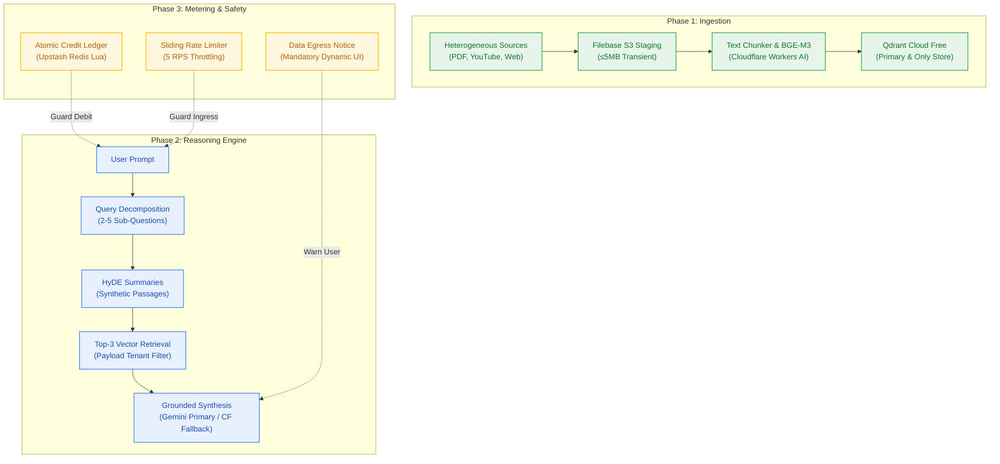
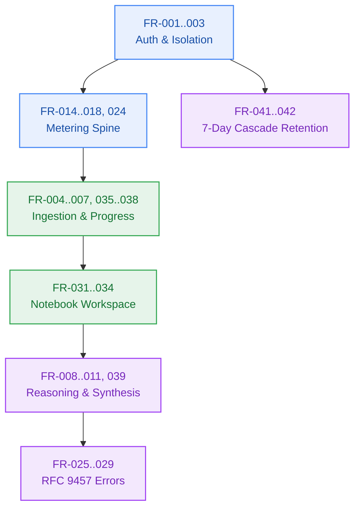
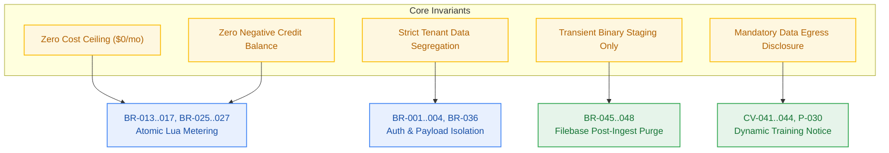
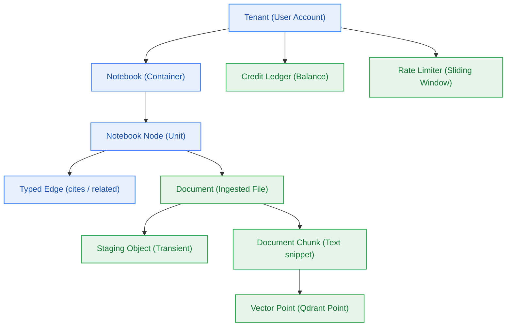

# Project Brief & Requirements Specification — Contextual AI Platform

> **Project:** Contextual AI Platform (`contextual`)  
> **Workflow ID:** `wf-contextual-001` · **Stage:** Stage 1 (Checkpoint 1 Requirements Sealed)  
> **Author:** analyst-agent · **Delivery Mode:** Balanced · **Target Maturity:** MVP · **Risk Tier:** HIGH  
> **Infrastructure Rule:** Strict $0.00/Month Cost Ceiling (`NFR-016`) across all cloud providers.  

---

## 1. Executive Summary & Problem Framing

### 1.1 Problem Statement
Knowledge workers, researchers, and developers constantly ingest information from disparate formats (academic PDFs, YouTube lecture transcripts, web documentation, personal markdown notes). Existing retrieval-augmented generation (RAG) tools suffer from three systemic flaws:
1. **Shallow Semantic Search:** Naive single-query vector lookup fails on nuanced questions that require cross-document synthesis.
2. **Infrastructure Bloat & Vendor Lock-In:** Traditional architectures require expensive always-on server clusters, specialized vector databases, and heavy monthly SaaS fees.
3. **Data Governance & Transparency Gaps:** AI vendors often train on user inputs without clear, honest data-routing disclosure to the end-user.

### 1.2 Proposed Solution
The **Contextual AI Platform** is an enterprise-grade conversational knowledge retrieval platform operating strictly within a **$0.00/month infrastructure ceiling** (no payment card stored on any vendor). It empowers authenticated users to ingest heterogeneous content into a personal notebook workspace, chunk and embed the knowledge into a high-performance vector store (Qdrant), and perform multi-step contextual question-answering powered by a 6-phase reasoning pipeline featuring query decomposition, Hypothetical Document Embeddings (HyDE), and grounded citation synthesis.

---

## 2. Functional Requirements (FR) Specification

| ID | Title | Priority | Actor / Trigger | Action & Expected Outcome | Source Trace |
|---|---|---|---|---|---|
| **FR-001** | Social OAuth Authentication | Must | Unauthenticated User / Login attempt | Authenticate via Clerk using Google or GitHub credentials; protected routes reject missing/invalid JWT with HTTP 401. | User Directive / Intake |
| **FR-002** | Conversation Thread Persistence | Must | Authenticated User / Chat action | Persist conversations, messages, and references in Neon PostgreSQL filtered by `user_id`. | User Directive |
| **FR-003** | Multi-Tenant Session Isolation | Must | API Request / Any query | Restrict data access strictly to authenticated requestor's tenant across SQL and Qdrant payloads. | BR-002 / Intake |
| **FR-004** | PDF Document Parsing | Must | User Upload / PDF file ≤ 5 MB | Background worker extracts text, headings, and page metadata off the HTTP cycle. | Intake / ADR-0003 |
| **FR-005** | YouTube Subtitle Extraction | Must | User Input / YouTube URL | Extract timestamped subtitles into structured chunk records asynchronously. | Intake |
| **FR-006** | Website Content Crawling | Must | User Input / Web URL | Crawl URL, strip boilerplate (navbars, scripts, ads), and convert content to clean Markdown. | Intake |
| **FR-007** | Vector DB Population | Must | Background Worker / Ingested chunks | Compute dense embeddings (BGE-M3) and upsert points to Qdrant with tenant payload `{ user_id, document_id, notebook_id }`. | Intake / ADR-0001 |
| **FR-008** | Question Decomposition | Must | Reasoning Engine / Complex prompt | Decompose prompt into an ordered array of 2 to 5 targeted sub-questions with semantic dependencies. | D-03 / Party-Mode |
| **FR-009** | HyDE Summary Generation | Must | Reasoning Engine / Sub-question | Generate hypothetical answer passages for each sub-question before vector retrieval. | D-03 / Party-Mode |
| **FR-010** | Multi-Vector Top-3 Retrieval | Must | Reasoning Engine / HyDE summary | Execute vector similarity search retrieving at most 3 contextual chunks per sub-question. | BR-008 / D-03 |
| **FR-011** | Context Aggregation & Synthesis | Must | Reasoning Engine / Chunks | Deduplicate chunks, build grounded prompt, and stream answer with clickable inline citations. | BR-009 / Intake |
| **FR-012** | Local Developer Setup | Must | Developer / Bootstrap | Containerized stack (`infra/compose.yaml`); `npm run dev:doctor` verifies 100% health in < 5m. | PTY-003 / Devprod |
| **FR-013** | Benchmark Suite | Must | QA / CI Pipeline | Automated load/stress tests (k6/autocannon) validating p95 latency and error thresholds. | NFR-005 / QA |
| **FR-014** | Credit Grant Allocation | Must | Daily Boundary / User request | Grant `CREDIT_GRANT_DEFAULT` (10) credits per account per day, resetting at `CREDIT_RESET_TZ`. | A-08, A-10 |
| **FR-015** | Metered Action Debit | Must | User / Metered Action | Debit `CREDIT_COST_LLM_ACTION` (0.5) or `CREDIT_COST_DOC_PROCESS` (1.0) atomically via Redis Lua. | BR-014 / PTY-010 |
| **FR-016** | Credit Exhaustion Short-Circuit | Must | User / Balance < Action Cost | Refuse request immediately with HTTP 402 `INSUFFICIENT_CREDITS`; zero calls to upstream providers. | BR-015 / A-02 |
| **FR-017** | Per-User Rate Limit | Must | User / Inbound Request | Enforce `RATE_LIMIT_RPS` (5 req/sec); 6th request inside 1s returns HTTP 429 with `Retry-After`. | BR-016 / PTY-010 |
| **FR-018** | Redis Shared State Layer | Must | Application Server / Any state mutation | Upstash Redis holds rate windows, credit balances, and session locks with Lua script atomicity. | BR-014 / D-07 |
| **FR-019** | Pluggable Memory Store | Must | Platform Modules / Memory access | Access long-term memory exclusively through `MemoryStore` interface (default mem0 self-hosted). | BR-018 / A-06 |
| **FR-020** | Modular Monolith & Extraction Seam | Must | System Build / Deployment | Shipped as single deployable with clean module boundaries; adapters allow standalone worker extraction. | D-09 / Architecture |
| **FR-021** | Turborepo Monorepo Layout | Must | Developer / Build | All apps (`landing`, `platform`) and packages (`contracts`, `config`, `db`, `ui`) managed in one repo. | CV-023 / PTY-003 |
| **FR-022** | Marketing Landing Page | Must | Unauthenticated Visitor / Crawl | Public, SEO-indexable page displaying product value, credit pricing, and provider data disclosures. | BR-024 / UX |
| **FR-023** | Metering Telemetry | Must | Platform Events / Metered action | Emit structured OTel events: credits debited, balance, throttles, and quota countdowns. | NFR-009 / BR-010 |
| **FR-024** | Daily Credit Reset | Must | Daily Boundary / Request | Balances reset at `CREDIT_RESET_TZ` (08:00 UTC); unspent credits permanently expire with no carry-over. | BR-025 / A-09 |
| **FR-025** | Structured Error Envelope | Must | Error Boundary / API Exception | All error responses format as RFC 9457 `application/problem+json` with all 5 mandatory members. | BR-028..032 / A-17 |
| **FR-026** | Service Limit Reporting | Must | Quota Classifier / Provider quota 429 | Return HTTP 402 `SERVICE_LIMIT_REACHED` naming `<quota_period>` and `<service_name>`. | A-16 / BR-029 |
| **FR-027** | Error Type Catalogue | Must | Error Boundary / Registration | Errors must strictly belong to the closed 17-member platform error catalogue. | CV-017 / Contracts |
| **FR-028** | Provider Quota Detection | Must | Adapter Boundary / Upstream error | Classify upstream errors into quota exhaustion vs outage; extract reset duration. | PTY-010 / Adapters |
| **FR-029** | Quota State Surfaced to Clients | Must | HTTP Handlers / Metered response | Return remaining credits, provider quota remaining, and reset seconds in response headers/body. | PTY-010 / Contracts |
| **FR-030** | AI Provider Data Handling Disclosure | Must | Public UI / All pages | Prominently disclose prompt data routing to generation provider under training terms (`CV-041`). | Q-002 / P-030 |
| **FR-031** | Notebook and Node Workspace | Must | User / Workspace navigation | Create notebooks populated by hierarchical text nodes or document reference nodes. | Intake / M6 Scope |
| **FR-032** | Typed Node Relations | Must | User / Edge creation | Restrict inter-node edges strictly to `cites` or `related`; arbitrary strings rejected with HTTP 400. | Intake / Architecture |
| **FR-033** | Document-Backed Nodes | Must | User / Ingestion attach | Attach ingested documents to notebook nodes; documents remain billable units resolving < 10 ms. | Intake / Ingestion |
| **FR-034** | Scoped Cross-Note Retrieval | Must | User / Scoped query | Execute retrieval over declared scope (node, branch, notebook); validate ownership before debit. | BR-036 / Retrieval |
| **FR-035** | Live Progress Stream | Must | Background Worker / Ingest job | Emit ordered SSE progress events; reconnect with `Last-Event-ID` replays missed events. Cap at 280s. | BR-034 / D-16 |
| **FR-036** | Deterministic Progress Reporting | Must | Progress UI / SSE event | Show percentage only with real denominator (PDF pages); indeterminate stages show step counters. | BR-036 / UX |
| **FR-037** | Ingestion Failure Refund Integrity | Must | BullMQ / Job terminal failure | Terminal ingestion failure reverses debited credit exactly once via atomic Lua script. | BR-033 / Billing |
| **FR-038** | Structured Ingestion Failure Reasons | Must | Ingestion Worker / Job failure | Return machine-readable reason from closed union: `PASSWORD_PROTECTED`, `NO_TEXT_LAYER`, etc. | Contracts / Worker |
| **FR-039** | Unavailable Sources Named in Answer | Must | Reasoning Engine / Inactive sources | Exclude processing/failed nodes from retrieval; explicitly list them in answer footer. | UX / Synthesis |
| **FR-040** | Non-Debiting Retry After Failure | Must | User / Retry action | Retrying a failed ingestion accepts previous `job_id` and does not debit credits a second time. | BR-033 / Billing |
| **FR-041** | Scheduled Maintenance Jobs | Must | Cron Runner / Scheduled trigger | Execute named maintenance jobs with heartbeats; missed run exceeding `2 × cadence` alerts. | BR-041 / Infra |
| **FR-042** | Retention Cascade Deletion | Must | Maintenance Cron / Weekly purge | Identify notebooks idle for ≥ 7 days; execute all-or-nothing cascade deletion with 30d tombstone. | ADR-0001 / BR-037 |

---

## 3. Non-Functional Requirements (NFR) Specification

| ID | Category | Metric | Measurable Threshold | Priority | Source Trace |
|---|---|---|---|---|---|
| **NFR-001** | Performance | Vector Search Latency | p95 < 100 ms for top-3 similarity query across working set ≤ 25,000 vectors | Must | Architecture / Qdrant |
| **NFR-002** | Performance | LLM Time-to-First-Token | p90 < 1,500 ms for streaming responses | Must | Architecture / Gemini |
| **NFR-003** | Performance | E2E Pipeline Latency | p90 < 4,500 ms for complete 6-stage reasoning pipeline | Must | Architecture |
| **NFR-004** | Performance | Ingestion Throughput | > 5 pages/sec for text PDFs ≤ 5 MB; < 30s for 1-hour YouTube transcript | Must | Worker Spec |
| **NFR-005** | Performance | Concurrency | ≥ 50 concurrent active users with < 1% error rate on mock provider harness | Must | QA / D-06 |
| **NFR-006** | Security | Auth Verification | 100% of protected routes reject invalid or absent Clerk JWT with HTTP 401 | Must | BR-001 |
| **NFR-007** | Security | Tenant Data Isolation | Zero cross-tenant data leakage in SQL queries and Qdrant payload filters | Must | BR-002 |
| **NFR-008** | Reliability | Worker Retry Policy | Exponential backoff (initial 2s, max 3 attempts) before marking job terminal | Must | BR-005 |
| **NFR-009** | Observability | Structured Telemetry | 100% of HTTP requests and jobs emit structured JSON with `correlation_id` via OTel | Must | BR-010 |
| **NFR-010** | DevX | Developer Bootstrap | Clean clone to healthy stack in < 5 minutes (`npm run dev:doctor`) | Must | Devprod |
| **NFR-011** | Metering | Debit Concurrency Safety | Balance never observed negative; zero lost updates on concurrent debits | Must | BR-013 |
| **NFR-012** | Rate Limiting | Decision Latency | Limiter evaluation p99 < 10 ms; strictly ≤ 5 req/sec admitted per user | Must | BR-016 |
| **NFR-013** | Resource | Redis Command Budget | ≤ 4 commands per metered request; total monthly ≤ 500,000 Upstash commands | Must | Upstash Research |
| **NFR-014** | Capacity | Memory Vendor Independence | Self-hosted mem0 on Cloudflare Workers; $0.00 monthly vendor retrieval fees | Must | ADR-0002 |
| **NFR-015** | Capacity | Daily LLM Headroom | Operations sized to fit daily quotas (CF 10k neurons/day; Gemini free RPD) | Must | Cloudflare Research |
| **NFR-016** | Cost Ceiling | Infrastructure Spend | **Strictly $0.00/month.** Zero payment cards stored with any vendor | Must | User Invariant |
| **NFR-017** | Durability | Idle Suspension Policy | Cluster keepalive every 48 hours; zero clusters suspended by vendor policy | Must | Qdrant Research |
| **NFR-018** | Frontend | Landing Performance | Google Lighthouse Performance ≥ 90; LCP < 2.0s on 4G profile | Must | UX / Landing |
| **NFR-019** | Architecture| Adapter Portability | Ingestion & memory modules extractable to worker with zero caller changes | Must | FR-020 |
| **NFR-020** | Metering | Quota Period Alignment | Daily-reset credits back daily provider quotas; zero mid-month outages | Must | A-14 |
| **NFR-021** | Headroom | Target DAU Sizing | System architecture supports ≥ 10 DAU consuming full daily credit grant | Must | Capacity Sizing |
| **NFR-022** | Resilience | Fallback Switching | Primary LLM exhaustion falls through to fallback provider transparently | Must | D-01 |
| **NFR-023** | Correctness | Idempotent Daily Reset | Reset executes exactly once per day per user under concurrent traffic | Must | BR-026 |
| **NFR-024** | Expiration | Zero Credit Carry-Over | Balance after reset equals `CREDIT_GRANT_DEFAULT`; unspent credits expire | Must | BR-025 |
| **NFR-025** | Error Safety| Error Code Exclusivity | Zero occurrences of `SERVICE_LIMIT_REACHED` for non-quota conditions | Must | BR-028 |
| **NFR-026** | Security | Zero Credential Leakage | Zero tokens, keys, DB URLs, or stack traces in responses or logs | Must | BR-012 |
| **NFR-027** | Error Safety| Error Latency | p99 < 50 ms to format and serialize RFC 9457 error payload | Must | Contracts |
| **NFR-028** | Stability | URI Immutability | Error `type` URIs remain strictly immutable across minor releases | Must | RFC 9457 |
| **NFR-029** | Contract | Machine-Readable Quota | Quota errors expose `service`, `quota_period`, `quota_used`, `resets_in_seconds` | Must | Contracts |
| **NFR-030** | Fidelity | Truthful Quota Periods | Reported `quota_period` matches provider's configured reset period | Must | A-15 |
| **NFR-031** | Governance | Maintenance Liveness | Crons emit heartbeats; absence of heartbeat in `2 × cadence` alerts | Must | Deployment |
| **NFR-032** | Efficiency | Cascade Footprint | Weekly cascade run consumes zero user credits and ≤ 1% daily embedding | Must | Architecture |

---

## 4. Non-Goals & Excluded Scope

1. **Commercial Payments & Credit Card Billing:** Strictly excluded in MVP. Commercial billing violates the $0.00/month infrastructure ceiling (`NFR-016`) and Vercel Hobby Terms of Service.
2. **Third-Party Data Durability & PITR:** Point-in-time recovery and cloud replication for Qdrant and Filebase are explicitly out of scope (`BR-048`). Data loss on free-tier providers is treated as permanent.
3. **Synchronous In-Band Ingestion:** Ingestion of large documents will never occur synchronously on the HTTP request cycle due to serverless execution limits.
4. **Credit Carry-Over Banking:** Accumulation of unused credits across daily boundaries is prohibited to protect provider daily quota headroom (`BR-025`).
5. **Arbitrary User-Defined Node Relations:** Inter-node edges are restricted strictly to `cites` and `related` (`FR-032`). Arbitrary knowledge graph schemas are deferred.

---

## 5. Formal Business Rules & Invariants (BR-001 to BR-048)

### 5.1 Business Rules Table
| # | Rule Statement | Kind | Source Trace | Testable |
|---|---|---|---|---|
| **BR-001** | Every request to protected endpoints MUST carry a cryptographically verified Clerk JWT session token. | always | Intake / Security | true |
| **BR-002** | The system MUST never expose, query, or return conversation history, notebooks, nodes, or vectors belonging to another tenant. | never | Intake / Multi-Tenant | true |
| **BR-003** | When a session token is expired or invalid, the API MUST handle by returning HTTP 401 with RFC 9457 problem payload. | handle | RFC 7519 / Contracts | true |
| **BR-004** | Ingestion pipelines MUST always attach `user_id` metadata to every text chunk before persisting vectors into Qdrant. | always | Intake / Qdrant | true |
| **BR-005** | Transient ingestion network failures MUST handle by retrying with exponential backoff up to 3 attempts before terminal failure. | handle | BullMQ Spec | true |
| **BR-006** | Vector population operations MUST always be idempotent; submitting identical document bytes MUST never create duplicate points. | always | Architecture | true |
| **BR-007** | The reasoning engine MUST always decompose complex queries into atomic sub-questions and generate HyDE summaries prior to retrieval. | always | D-03 / Reasoning | true |
| **BR-008** | Each HyDE summary search in the vector database MUST always retrieve at most the top-3 most relevant contextual chunks. | always | D-03 / Retrieval | true |
| **BR-009** | The LLM synthesis step MUST never fabricate facts outside retrieved context; if context is insufficient, it MUST handle by stating it. | never | Prompt Spec | true |
| **BR-010** | All web routes and background workers MUST always emit structured JSON logs tagged with `correlation_id` via OTel. | always | Telemetry Spec | true |
| **BR-011** | Concurrency overload MUST handle via backpressure and rate limiting (HTTP 429), never by dropping tasks silently. | handle | RFC 6585 | true |
| **BR-012** | Raw user credentials, OAuth tokens, and API secret keys MUST never appear in application logs, database tables, or vector payloads. | never | Security Baseline | true |
| **BR-013** | A user's credit balance MUST never be observed as a negative number under any concurrency, race condition, or partial failure. | never | Billing Spec | true |
| **BR-014** | Every metered action MUST always debit configured costs via a single atomic Redis Lua script before downstream work begins. | always | PTY-010 / Redis | true |
| **BR-015** | Requests refused for insufficient credits MUST never reach downstream LLMs or workers, returning HTTP 402 `INSUFFICIENT_CREDITS`. | never | A-02 / Billing | true |
| **BR-016** | Requests exceeding `RATE_LIMIT_RPS` MUST handle by returning HTTP 429 with a valid `Retry-After` header. | handle | RFC 6585 | true |
| **BR-017** | A request rejected by the rate limiter MUST never debit credits. | never | A-03 / Billing | true |
| **BR-018** | All memory operations MUST always pass through the `MemoryStore` interface; domain code MUST never import vendor memory SDKs. | always | A-06 / Architecture | true |
| **BR-019** | Platform modules MUST always communicate through declared service interfaces; cross-module internal file imports are strictly forbidden. | always | CV-001..004 | true |
| **BR-020** | Every service adapter MUST always be implementable either in-process or as an out-of-process worker without altering caller behavior. | always | FR-020 | true |
| **BR-021** | Credit costs, grants, limits, and timeouts MUST never be hardcoded in source; they MUST always be read from validated configuration. | never | CV-022a | true |
| **BR-022** | Upstream provider quota exhaustion MUST always surface as an explicit typed error (`SERVICE_LIMIT_REACHED`), never silent degradation. | always | A-16 / Error Layer | true |
| **BR-023** | All deployables MUST always reside in a single Turborepo repository, sharing code exclusively via `@repo/*` packages. | always | FR-021 | true |
| **BR-024** | The marketing landing page MUST never require authentication and MUST always return HTTP 200 with zero authenticated user data. | never | FR-022 | true |
| **BR-025** | At `CREDIT_RESET_TZ` (08:00 UTC), balances MUST always reset to `CREDIT_GRANT_DEFAULT`; unspent credits MUST always expire. | always | A-09, A-10 | true |
| **BR-026** | Daily resets MUST always be idempotent across concurrent requests, guarded by `SET reset:{day}:{user} 1 NX` keyed off Redis TIME. | always | PTY-010 | true |
| **BR-027** | Metered credits MUST never consume quotas with mismatched reset periods; primary LLM exhaustion MUST always fallback transparently. | always | A-14 / D-01 | true |
| **BR-028** | `SERVICE_LIMIT_REACHED` MUST never be used for any condition other than provider quota exhaustion. | never | NFR-025 | true |
| **BR-029** | Quota exhaustion MUST always return HTTP 402 with template `"<quota_period> limit reached (<service_name>): 
"`. | always | A-15 / Contracts | true |
| **BR-030** | Reported `<quota_period>` MUST always reflect the provider's configured reset period (`daily` vs `monthly`), never hardcoded strings. | always | A-15 | true |
| **BR-031** | Error responses MUST never contain API keys, connection strings, raw vendor dumps, or internal stack traces. | never | NFR-026 | true |
| **BR-032** | Clients MUST always branch on the immutable `type` URI; client code MUST never parse human-readable `detail` prose. | always | RFC 9457 | true |
| **BR-033** | Retrying a terminally failed ingestion MUST never debit credits a second time. | never | FR-040 | true |
| **BR-034** | An SSE progress stream MUST never outlive `SSE_MAX_LIFETIME_SECONDS` (hard capped at 280s to stay below Vercel's 300s ceiling). | never | D-16 | true |
| **BR-035** | SSE connections exceeding `SSE_MAX_CONCURRENT_CONNECTIONS` MUST handle by returning HTTP 503 `PROGRESS_STREAM_UNAVAILABLE`. | handle | Architecture | true |
| **BR-036** | Cross-note scopes MUST always be validated against user ownership before any credit debit is committed. | always | Security Spec | true |
| **BR-037** | Notebooks with no user-visible activity for ≥ `NOTEBOOK_RETENTION_DAYS` (7) MUST always be selected for deletion by maintenance cron. | always | ADR-0001 | true |
| **BR-038** | Notebooks MUST always expose `expires_at` and emit a warning at `NOTEBOOK_WARN_BEFORE_HOURS` (24h) remaining; deletion MUST never occur undisclosed. | always | UX Spec | true |
| **BR-039** | Cascade deletion MUST never be partial; it removes vector points, Filebase staging objects, notebook rows, and chat history. | never | Architecture | true |
| **BR-040** | Retention cascades MUST always be idempotent; re-running against an already-deleted notebook is a safe no-op. | always | Maintenance Spec | true |
| **BR-041** | A single cron run MUST never delete more than `MAX_NOTEBOOKS_DELETED_PER_RUN`; excess expired notebooks are deferred. | never | Architecture | true |
| **BR-042** | Any store failure during cascade execution MUST handle by aborting with `deleted: 0`, rolling back relational mutations. | handle | Data Architecture | true |
| **BR-043** | The platform MUST always run an independent 48-hour keepalive probe against Qdrant, completely separate from deletion runs. | always | ADR-0001 / Research | true |
| **BR-044** | Deleted notebooks MUST always leave a tombstone row retained for ≥ 30 days, returning HTTP 410 `NOTEBOOK_EXPIRED`, never 404. | always | A-23 | true |
| **BR-045** | Uploads exceeding `UPLOAD_MAX_BYTES` (5 MB) MUST always return HTTP 413 and debit zero credits without invoking upstream providers. | always | ADR-0003 | true |
| **BR-046** | Uploaded binaries in Filebase MUST always be deleted once chunks are written to Qdrant; Filebase is transient staging only. | always | ADR-0003 Directive 2 | true |
| **BR-047** | The vector store MUST always be the primary and only record of ingested content; zero chunk text is stored in Neon or Filebase. | always | ADR-0003 / PTY-005 | true |
| **BR-048** | Loss of data held by third-party stores (Qdrant, Filebase) MUST always be treated as permanent; backup and PITR are out of scope. | always | Architecture Baseline | true |

---

## 6. §12 Domain Glossary (Ubiquitous Language)

| Term | 15-Year-Old Plain English Definition | Synonyms (Resolved) | Code Identifier Mapping | Used By |
|---|---|---|---|---|
| **Tenant** | Like having your own locked room in a shared apartment building where nobody else can see or touch your stuff. | Workspace, Account, User Pool | `TenantContext` / `tenantId`, `userId` | `clerk-auth`, `credit-ledger`, `db` |
| **Notebook** | A personal project binder holding your notes, documents, and chat conversations about a specific topic. | Binder, Project Folder, Collection | `Notebook` / `notebookId` | `notebook-service`, `retrieval` |
| **Notebook Node** | A single card or page inside your notebook, holding either written text or a link to an uploaded document. | Card, Canvas Item, Note | `NotebookNode` / `nodeId` | `notebook-service`, `ui` |
| **Typed Edge** | A labeled piece of string connecting two cards, declaring either that Card A *quotes/cites* Card B, or that they are *related*. | Link, Relation, Connection | `NodeRelation` / `relationType` | `notebook-service`, `db` |
| **Document** | An uploaded file (PDF, YouTube transcript, or webpage) attached to a card inside your notebook. | Upload, Source, File Attachment | `DocumentRecord` / `documentId` | `ingestion-worker`, `filebase` |
| **Staging Object** | A temporary holding box in cloud storage where an uploaded file waits while the worker reads it, and gets deleted immediately after. | Temp File, Inflight Upload | `StagingObject` / `stagingKey` | `filebase-adapter`, `worker` |
| **Document Chunk** | A small, 500-word paragraph sliced out of a big document so the AI can read and find it quickly. | Passage, Segment, Text Block | `DocumentChunk` / `chunkId` | `chunker`, `qdrant-adapter` |
| **Vector Point** | A math coordinate representing the meaning of a chunk of text, stored in the vector database so similar ideas sit close together. | Embedding, Index Entry | `VectorPoint` / `pointId` | `qdrant-adapter`, `workers-ai` |
| **HyDE Summary** | A fake, imagined answer generated by the AI before searching, which helps it find real documents that talk about the same idea. | Synthetic Passage, Hypothetical Answer | `HydePassage` / `hydeSummary` | `reasoning-engine` |
| **Credit Ledger** | A digital wallet tracking your daily allowance of action points, ensuring you never spend more than you have. | Token Balance, Allowance, Quota Counter | `CreditLedger` / `ledgerBalance` | `credit-ledger`, `redis-adapter` |
| **Sliding Window Limiter** | A bouncer at the door counting how many requests you make every second, asking you to wait if you tap faster than 5 times a second. | Rate Limiter, Traffic Throttler | `RateLimiter` / `slidingWindow` | `rate-limiter`, `middleware` |
| **Quota Classifier** | An interpreter that reads cryptic error messages from AI providers to tell whether they ran out of daily fuel or just crashed. | Error Mapper, Quota Detector | `QuotaClassifier` / `classifyQuota` | `quota-classifier`, `adapters` |
| **Retention Cascade** | A weekly digital cleaning crew that looks for notebooks you haven't opened in a week and neatly recycles them across all storage boxes. | Auto-Purge, Idle Cleanup, Eviction Sweeper | `RetentionCascade` / `runCascade` | `maintenance-worker`, `crons` |
| **Tombstone** | A polite signpost left behind where an expired notebook used to be, explaining that it was deleted because a week went by without use. | Expired Record, Ghost Row | `TombstoneRecord` / `isTombstoned` | `db`, `notebook-service` |
| **Keepalive Probe** | A gentle ping sent every two days to wake up the vector database so it doesn't fall asleep and get shut down by its provider. | Heartbeat Ping, Liveness Touch | `ClusterProbe` / `sendKeepalive` | `maintenance-crons` |
| **Progress Stream** | A live radio broadcast from the background worker telling your screen exactly what step of reading your document it is currently on. | SSE Channel, Live Feed | `ProgressStream` / `sseStream` | `progress-service`, `ui` |
| **Provider Disclosure** | An honest, un-hideable banner telling you upfront that your questions travel to Google's free servers and may be reviewed or trained on. | Privacy Notice, Egress Warning | `ProviderDisclosure` / `contentEgress` | `ui`, `landing-page` |
| **Memory Store** | A generic filing cabinet adapter for storing long-term user memories without tying the app directly to one specific memory company. | User Memory, Context Cache | `MemoryStore` / `memoryAdapter` | `memory-service`, `mem0-adapter` |

---
*Sealed by analyst-agent at Checkpoint 1 (Gate G1).*
