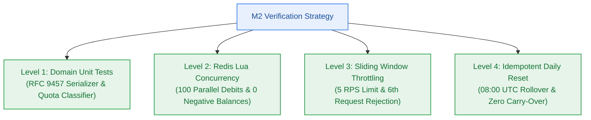

# Verification Plan — Milestone M2: Metering Spine & Quota Throttling

> **Author:** test-agent (Verification Architect & Quality Gatekeeper) · **Status:** Final  
> **Grounding:** `_documentation/planning/prd.md` §3/§5/§6, `conventions.md` §4, `m2-metering-spine/milestone.md`  
> **Target Version:** `v0.2.0` · **Gate:** G6 Verification Baseline  

---

## 1. Concrete Story Verification Scenarios

### S2.1: Atomic Upstash Redis Lua Credit Ledger Service
| TC ID | Scenario Description | Test Input | Expected Observable Outcome | Verification Command | Status |
|---|---|---|---|---|:---:|
| **TC-2.1.1** | Account initialization | Uninitialized user `usr_test_01` | Balance initialized to `10.0` credits | `bun test credit-ledger.test.ts` | ⬜ PENDING |
| **TC-2.1.2** | Single metered debit | Debit `0.5` credits on balance `10.0` | Returns `{ success: true, remaining: 9.5 }` | `bun test credit-ledger.test.ts` | ⬜ PENDING |
| **TC-2.1.3** | Concurrent race conditions | 100 concurrent parallel debits of `0.5` against `10.0` | Exactly 20 debits succeed; 80 debits fail; final balance strictly `0.0`; zero negative balance | `bun test credit-ledger.test.ts` | ⬜ PENDING |

### S2.2: Per-User 5 RPS Sliding Window Rate Limiter
| TC ID | Scenario Description | Test Input | Expected Observable Outcome | Verification Command | Status |
|---|---|---|---|---|:---:|
| **TC-2.2.1** | Admitted within window | 5 requests within 1000ms window | All 5 return `{ allowed: true, remaining: 4..0 }` | `bun test rate-limiter.test.ts` | ⬜ PENDING |
| **TC-2.2.2** | Throttled on 6th request | 6th request within same 1000ms window | Returns `{ allowed: false, retryAfterSeconds: 1 }` | `bun test rate-limiter.test.ts` | ⬜ PENDING |
| **TC-2.2.3** | Throttled requests zero debit | Rate-limited request attempting debit | Account balance remains unchanged (`BR-017`) | `bun test rate-limiter.test.ts` | ⬜ PENDING |

### S2.3: Ingress Credit Guard & HTTP 402 Short-Circuit
| TC ID | Scenario Description | Test Input | Expected Observable Outcome | Verification Command | Status |
|---|---|---|---|---|:---:|
| **TC-2.3.1** | Insufficient balance check | Account balance `0.2`, action cost `0.5` | Aborts immediately with HTTP 402 `INSUFFICIENT_CREDITS` | `bun test metering-guard.test.ts` | ⬜ PENDING |
| **TC-2.3.2** | Zero upstream calls | Request rejected by credit guard | Downstream handler/mock called 0 times (`BR-015`) | `bun test metering-guard.test.ts` | ⬜ PENDING |

### S2.4: Closed 17-Member RFC 9457 Error Catalogue
| TC ID | Scenario Description | Test Input | Expected Observable Outcome | Verification Command | Status |
|---|---|---|---|---|:---:|
| **TC-2.4.1** | RFC 9457 top-level envelope | Error formatted via `serializeProblemDetails` | Contains `type`, `title`, `status`, `detail`, `instance` | `bun test errors.test.ts` | ⬜ PENDING |
| **TC-2.4.2** | Closed union type safety | Invalid type URI passed | TypeScript compile error & runtime schema validation error | `bun test errors.test.ts` | ⬜ PENDING |
| **TC-2.4.3** | Sensitive credential redaction | Exception with DB connection string / API key | Payload strips credentials and stack trace (`NFR-026`) | `bun test errors.test.ts` | ⬜ PENDING |

### S2.5: Upstream Quota Classifier & RateLimit Headers
| TC ID | Scenario Description | Test Input | Expected Observable Outcome | Verification Command | Status |
|---|---|---|---|---|:---:|
| **TC-2.5.1** | Google 429 quota mapping | Google error `RESOURCE_EXHAUSTED` (429) | Maps to HTTP 402 `SERVICE_LIMIT_REACHED` (`BR-028`) | `bun test quota-classifier.test.ts` | ⬜ PENDING |
| **TC-2.5.2** | Exclusivity of quota error | Upstream 500 internal server error | Maps to HTTP 502; NEVER emits `SERVICE_LIMIT_REACHED` | `bun test quota-classifier.test.ts` | ⬜ PENDING |
| **TC-2.5.3** | Response header injection | Valid API response | Injects `RateLimit-Policy`, `RateLimit`, `Retry-After` | `bun test quota-classifier.test.ts` | ⬜ PENDING |

### S2.6: Idempotent Daily 08:00 UTC Reset
| TC ID | Scenario Description | Test Input | Expected Observable Outcome | Verification Command | Status |
|---|---|---|---|---|:---:|
| **TC-2.6.1** | Daily reset balance | Account with `3.5` credits at 08:00 UTC | Balance set to `10.0`; unspent `3.5` expires | `bun test daily-reset.test.ts` | ⬜ PENDING |
| **TC-2.6.2** | Concurrent reset idempotency | 10 parallel triggers of `executeDailyReset` | Exactly 1 executes; 9 return idempotent no-op | `bun test daily-reset.test.ts` | ⬜ PENDING |

---

## 2. Exhaustive Truth Tables

### Credit Debit Decision Truth Table
| Balance | Action Cost | Is Throttled? | Expected Decision | HTTP Status Code | Remaining Balance | Downstream Invoked? |
|:---:|:---:|:---:|:---:|:---:|:---:|:---:|
| `10.0` | `0.5` | No | Debit Approved | 200 OK | `9.5` | Yes |
| `0.5` | `0.5` | No | Debit Approved | 200 OK | `0.0` | Yes |
| `0.4` | `0.5` | No | Insufficient Credits | 402 Payment Required | `0.4` | **No** |
| `0.0` | `1.0` | No | Insufficient Credits | 402 Payment Required | `0.0` | **No** |
| `10.0` | `0.5` | **Yes (6th RPS)** | Rate Limit Throttled | 429 Too Many Requests | `10.0` | **No** |
| `0.2` | `0.5` | **Yes (6th RPS)** | Rate Limit Throttled | 429 Too Many Requests | `0.2` | **No** |

---

## 3. Performance SLA Verification

| Metric | Target SLA Threshold | Observed Test Metric | Status | Evaluation Method |
|---|---|---|:---:|---|
| **Rate Limiter Evaluation** | p99 < 10 ms | *To be recorded on build* | ⬜ PENDING | In-memory Redis sliding window benchmark (`NFR-012`) |
| **Error Serialization Latency** | p99 < 50 ms | *To be recorded on build* | ⬜ PENDING | RFC 9457 serialization micro-benchmark (`NFR-027`) |
| **Debit Redis Operations** | ≤ 2 Redis commands / req | *To be recorded on build* | ⬜ PENDING | Upstash EVALSHA monitor counter (`NFR-013`) |

---
*Authored by test-agent at Checkpoint 3/4.*
