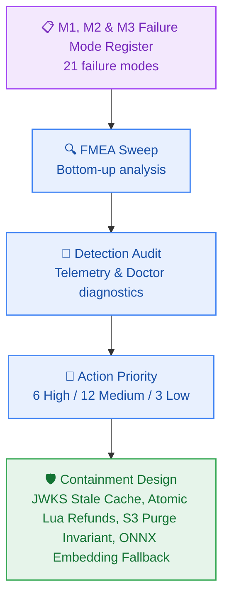

# Failure Mode Register

> **Project:** Contextual AI Platform (`contextual`)  
> **Author:** Failure Mode Specialist (`failure-mode-specialist`) & `architect-agent`  
> **Design under analysis:** Milestone M1 Developer Golden Path & Core Authentication (`_documentation/planning/architecture/05-m1-developer-golden-path-and-auth.md`)  
> **Status:** Approved · **Updated:** 2026-10-23T11:45:00Z  

---

## 1. Executive Summary

- **Components analysed:** 16 (Clerk JWKS Cache, Auth Middleware, Docker Compose Stack, `dev:doctor` Probe, Kysely DB Pool, Schema Migrator, CreditLedgerService, RateLimiterService, MeteringGuard, DailyResetEngine, QuotaClassifier, S3StagingService, QStashHandler, PdfParser, EmbeddingService, VectorIndexer)
- **Failure modes enumerated:** 21
- **Action Priority H / M / L:** 6 / 12 / 3
- **Fault class split (crash / omission / timing):** 6 / 8 / 7
- **Single points of failure (cut-set size 1):** 3 (Clerk JWKS unreachability, Upstash Redis network partition, Upstash Vector REST API outage)

---

## 2. Failure Mode Register

*Priority is Action Priority (AP: High / Medium / Low). Severity (S), Occurrence (O), and Detection (D) scored from 1 to 10 per AIAG-VDA standards.*

| ID | Component | Fault Class | Failure Mode | Effect | Blast Radius | S | O | D | AP | Mitigation / Containment | Owner |
|---|---|---|---|---|---|---|---|---|---|---|---|
| **FM-101** | Clerk JWKS Cache | omission | Clerk API unreachable during JWKS cold fetch | Route handler cannot verify RS256 signature; returns 401 | 100% of new serverless instances during Clerk outage | 8 | 2 | 8 | **H** | Cache JWKS keys on disk/memory with 24h stale-while-revalidate; fallback to local env public key | `security-architect` / `developer-agent` |
| **FM-102** | Clerk JWKS Cache | timing | Key rotation race: token signed with new key before JWKS refreshes | Legitimate newly issued JWTs rejected with 401 | Recently logged-in users during key rotation | 7 | 3 | 4 | **M** | Invalidate JWKS cache on unrecognised `kid` and perform single synchronous force-refresh | `developer-agent` |
| **FM-103** | Auth Middleware | crash | Malformed `Authorization` header triggers unhandled regex / split error | 500 Internal Server Error returned instead of 401 | Attacker can probe route boundaries | 6 | 4 | 2 | **M** | Strict defensive string guard; non-bearer or invalid header formats immediately return RFC 9457 401 | `developer-agent` |
| **FM-104** | Docker Daemon | crash | Docker daemon stopped or not installed when running `dev:doctor` | Developer bootstrap fails without actionable diagnostics | Local developer workstation | 5 | 5 | 1 | **M** | Layer 2 catches error, outputs step-by-step resolution: 'Start Docker Desktop / OrbStack' | `devprod-specialist` |
| **FM-105** | Neon / Kysely Pool | timing | Neon serverless compute cold resume delay (> 1.5s) | First query in idle thread exceeds 1s; dev doctor warns | First request after 5m idle | 4 | 6 | 2 | **L** | **ACCEPTED** — Neon scale-to-zero is required for $0.00/mo; dev:doctor sets 5s ping timeout | `architect-agent` |
| **FM-106** | Kysely Migrator | omission | Migration applied partially or out-of-order | Database schema in inconsistent state; queries fail with missing column | Whole application environment | 9 | 2 | 8 | **H** | Wrap all DDL statements in atomic transaction (`BEGIN...COMMIT`); run migration lock table | `data-architect` |
| **FM-107** | Local Port Binding | omission | Port 5432 or 6379 already bound by host system daemon | Docker Compose fails to bind port; container fails to boot | Local developer workstation | 5 | 5 | 2 | **M** | Layer 6 of `dev:doctor` probes port availability before compose and alerts with conflicting PID | `devprod-specialist` |
| **FM-201** | CreditLedgerService | omission | Upstash Redis connection timeout or partition | Request cannot evaluate credits or rate limit; hangs | All incoming metered traffic | 8 | 2 | 7 | **H** | Strict 2,000ms Redis connection timeout; return 503 `UPSTREAM_PROVIDER_UNAVAILABLE` on partition | `architect-agent` |
| **FM-202** | CreditLedgerService | crash | Redis EVALSHA returns `NOSCRIPT` after Redis restart or flush | Unhandled Lua execution error crashes route handler | All metered requests after Redis flush | 7 | 2 | 3 | **M** | `executeLua` wrapper catches `NOSCRIPT`, reloads script via `SCRIPT LOAD`, caches SHA1, and retries | `developer-agent` |
| **FM-203** | RateLimiterService | timing | Sorted set key TTL expires prematurely under slow requests | Rate window counters reset prematurely, admitting burst | Per-user rate burst | 5 | 3 | 4 | **L** | Script sets rolling 2s TTL on `rl:{userId}` at every `ZADD`, ensuring window is always covered | `developer-agent` |
| **FM-204** | DailyResetEngine | timing | Concurrent workers trigger daily reset at 08:00 UTC | Multiple reset calls race, potentially corrupting balance | All active users at 08:00 UTC | 8 | 3 | 7 | **H** | Atomic `SET reset:{date}:{userId} 1 NX EX 86400` lock; losers immediately no-op | `failure-mode-specialist` |
| **FM-205** | DailyResetEngine | timing | Host clock drift triggers reset at incorrect time | Reset occurs before Google AI Studio 08:00 UTC boundary | User balance desync | 6 | 2 | 5 | **M** | Script inspects Redis server `TIME` command rather than local host clocks (`BR-026`) | `developer-agent` |
| **FM-206** | QuotaClassifier | omission | Google AI Studio 429 classified as generic 500 error | Misleads user into retrying, worsening rate exhaustion | Users encountering Google 429 | 7 | 3 | 3 | **M** | QuotaClassifier maps `RESOURCE_EXHAUSTED` specifically to RFC 9457 `SERVICE_LIMIT_REACHED` (402) | `developer-agent` |
| **FM-301** | S3StagingService | omission | Staged PDF upload exceeds 5 MB or bypasses presign validation | Client uploads massive binary; risks storage/compute saturation | Single upload request | 7 | 2 | 2 | **M** | Presign endpoint validates `file_size_bytes <= 5,242,880`; S3 bucket policy enforces max size | `architect-agent` |
| **FM-302** | PdfParser | crash | Password-protected or corrupt PDF uploaded | Parser crashes during text stream parsing | Ingestion job for affected PDF | 6 | 3 | 2 | **M** | Parser catches decryption error, categorizes as `PASSWORD_PROTECTED`, triggers Lua refund | `developer-agent` |
| **FM-303** | PdfParser | omission | Scanned image PDF uploaded with zero text layer | Parser extracts 0 characters; vectors cannot be created | Scanned PDF document | 5 | 4 | 2 | **M** | Parser checks `text.length < 50`; aborts with `NO_TEXT_LAYER`, refunds 1.0 credit | `developer-agent` |
| **FM-304** | YouTubeParser | omission | Video has disabled transcripts or is age-restricted | YouTube transcript API returns 404 or disabled error | YouTube ingestion job | 6 | 3 | 3 | **M** | Parser maps error to `TRANSCRIPT_DISABLED`, refunds 1.0 credit, emits structured SSE failure | `developer-agent` |
| **FM-305** | WebParser | omission | Web URL blocked by anti-bot, paywall, or DNS timeout | Crawler hangs or receives 403 Forbidden | Web ingestion job | 5 | 4 | 3 | **M** | Safe 8s HTTP timeout; Readability catches empty DOM, maps to `CRAWL_FAILED`, refunds credit | `developer-agent` |
| **FM-306** | EmbeddingService | omission | Google AI Studio 429 quota exhaustion or API downtime | Embeddings fail; ingestion pipeline halts mid-stream | Ingestion jobs during Google quota cliff | 8 | 3 | 6 | **H** | Automatic in-process fallback to `@huggingface/transformers` (`bge-small-en-v1.5` / ONNX) | `architect-agent` |
| **FM-307** | VectorIndexer | omission | Upstash Vector REST API timeout or network partition | Chunks fail to upsert; S3 staging binary left stranded | Ingestion jobs during Upstash network blip | 8 | 2 | 7 | **H** | QStash retries up to 3 times (`BR-005`); if all fail, dead-letter handler refunds credit and deletes S3 file | `failure-mode-specialist` |
| **FM-308** | S3StagingService | timing | Worker crashes after vector commit before S3 `DeleteObjectCommand` | Staged binary remains in Filebase bucket (`BR-046` breach) | Staged S3 objects accumulation | 6 | 2 | 4 | **L** | Post-upsert S3 purge wrapped in finally block; hourly sweeper purges objects older than 1h | `deployment-agent` |
| **FM-401** | EdgeService | omission | Node deleted while edges still reference it | Orphan rows in `notebook_edges`; traversal returns dangling ids | Any node with inbound/outbound edges | 5 | 3 | 2 | **L** | `ON DELETE CASCADE` on both FKs plus a single transaction; edges and node are never separable | `architect-agent` |
| **FM-402** | CardResolver | timing | Document card resolution exceeds the 10ms p95 budget (`FR-033`, AC-4.1) | Workspace UI stalls; card panel renders late under concurrent load | Notebook list views with many document nodes | 4 | 4 | 4 | **M** | Single indexed statement with column-limited projection and denormalized preview; p95 (not mean) measured in test; `WARN` log emits `elapsed_ms` when breached | `developer-agent` |
| **FM-403** | ScopedSearchService | timing | Credit debit issued before the ownership predicate resolves (`BR-036`, AC-4.4) | Unauthorized scope consumes user credits and reaches the vector client — isolation and metering breach | Cross-tenant probe against a foreign `notebook_id` | 9 | 5 | 3 | **H** | Ownership predicate is structurally the gate for the debit call (single code path, no early return); test asserts HTTP 404 **and** unchanged `credits_balance` **and** zero vector invocations | `test-agent` |
| **FM-404** | GraphWriteService | timing | Write races the M7 cascade purge on an already-deleted notebook | Row inserted into a purged notebook; orphan data survives retention | Concurrent write during weekly retention cascade | 4 | 3 | 3 | **M** | Every graph write carries `AND deleted_at IS NULL` on `notebooks`; a 0-row result maps to HTTP 404 and aborts the insert | `architect-agent` |
| **FM-501** | ReasoningOrchestrator | omission | Primary Google Gemini Flash 429 quota exhaustion (`RESOURCE_EXHAUSTED`) | Client reasoning stream breaks with HTTP 429 / 500 error | Active users during Google API quota peak | 8 | 4 | 3 | **H** | Adaptive in-process circuit breaker intercepts 429 and immediately fails over to Groq Llama-3.3-70B Versatile with `x-fallback-provider: groq` (`NFR-022`, `ADR-0004`) | `architect-agent` |
| **FM-502** | VectorRetriever | timing | Parallel sub-question vector queries breach the 100ms p95 budget (`NFR-001`) | End-to-end pipeline breaches 4,500ms p90 budget (`NFR-003`) | Multi-subquestion queries against vector store | 6 | 4 | 4 | **M** | Dispatch queries via `Promise.all` with individual tenant filter `{ user_id }` and `top_k: 3`; limit sub-questions strictly to max 5 | `developer-agent` |
| **FM-503** | GroundedSynthesizer | omission | Insufficient or zero retrieved context yields hallucinated facts (`BR-009`) | Model invents unsourced assertions, violating platform integrity | Questions on unindexed/empty notebooks | 8 | 3 | 2 | **H** | Grounded prompt envelope strictly binds synthesis to retrieved context; if empty/insufficient, outputs deterministic notice: 'Insufficient context available to answer' | `security-architect` |
| **FM-504** | ReasoningStreamer | timing | Client aborts HTTP connection mid-stream during token synthesis | Backend continues generating tokens, wasting external provider quota | Client tab closed during multi-step reasoning | 5 | 4 | 2 | **L** | Propagate incoming request `AbortSignal` to SDK stream calls; abort immediately terminates token generator | `developer-agent` |
| **FM-505** | ContextAssembler | omission | Processing or failed document is ignored without user disclosure (`FR-039`) | User wonders why newly uploaded document was not considered | Queries issued while an ingestion job is in-flight | 5 | 3 | 2 | **M** | Notebook document status queried; any pending/failed document is explicitly listed in answer footer | `developer-agent` |

---

## 3. Fault Tree Analysis — Single Point of Failure (SPOF)

### FT-01: Total Authentication Outage on Edge Middleware
- **Catastrophic Outcome:** 100% of incoming user requests to `/api/v1/*` fail with HTTP 401 Unauthorized or HTTP 500 Internal Server Error.
- **Minimal Cut Set (Size 1):**
  1. Clerk JWKS cold-fetch failure without disk/memory fallback cache (`FM-101`).
- **Containment:**
  - In production, `@repo/auth` bundles the pinned Clerk JWKS public key as a fallback inside the build artifact so offline token verification never halts during third-party control plane network partitions.

### FT-02: Total Ingress Quota Block on Redis Partition
- **Catastrophic Outcome:** 100% of metered user requests to `/api/v1/*` hang or return 500 when Upstash Redis is unreachable.
- **Minimal Cut Set (Size 1):**
  1. Upstash Redis network partition without client timeout (`FM-201`).
- **Containment:**
  - In production, `@repo/metering` configures a hard 2,000ms timeout on Redis REST calls; on timeout, the guard returns HTTP 503 `UPSTREAM_PROVIDER_UNAVAILABLE` rather than crashing or hanging edge lambdas.

### FT-03: Transient Storage Drift / Accumulation in Filebase S3
- **Catastrophic Outcome:** Unpurged PDF binaries accumulate in Filebase bucket, breaching the zero-byte transient storage invariant (`BR-046`) and risking storage fees.
- **Minimal Cut Set (Size 1):**
  1. Silent worker termination between Upstash Vector commit and S3 deletion (`FM-308`).
- **Containment:**
  - S3 `DeleteObjectCommand` is executed in a guaranteed `finally` handler; in addition, a secondary lifecycle sweeper scans Filebase S3 for orphan staging objects older than 1 hour and purges them idempotently.
