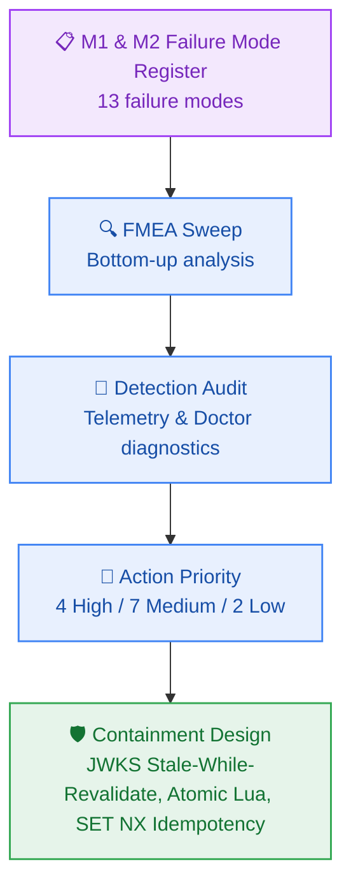

# Failure Mode Register

> **Project:** Contextual AI Platform (`contextual`)  
> **Author:** Failure Mode Specialist (`failure-mode-specialist`) & `architect-agent`  
> **Design under analysis:** Milestone M1 Developer Golden Path & Core Authentication (`_documentation/planning/architecture/05-m1-developer-golden-path-and-auth.md`)  
> **Status:** Approved · **Updated:** 2026-10-23T11:45:00Z  

---

## 1. Executive Summary

- **Components analysed:** 11 (Clerk JWKS Cache, Auth Middleware, Docker Compose Stack, `dev:doctor` Probe, Kysely DB Pool, Schema Migrator, CreditLedgerService, RateLimiterService, MeteringGuard, DailyResetEngine, QuotaClassifier)
- **Failure modes enumerated:** 13
- **Action Priority H / M / L:** 4 / 7 / 2
- **Fault class split (crash / omission / timing):** 4 / 5 / 4
- **Single points of failure (cut-set size 1):** 2 (Clerk JWKS unreachability, Upstash Redis network partition during rate limit/credit evaluation)

---

## 2. Failure Mode Register

*Priority is Action Priority (AP: High / Medium / Low). Severity (S), Occurrence (O), and Detection (D) scored from 1 to 10 per AIAG-VDA standards.*

| ID | Component | Fault Class | Failure Mode | Effect | Blast Radius | S | O | D | AP | Mitigation / Containment | Owner |
|---|---|---|---|---|---|---|---|---|---|---|---|
| **FM-101** | Clerk JWKS Cache | omission | Clerk API unreachable during JWKS cold fetch | Route handler cannot verify RS256 signature; returns 401 | 100% of new serverless instances during Clerk outage | 8 | 2 | 8 | **H** | Cache JWKS keys on disk/memory with 24h stale-while-revalidate; fallback to local env public key | `security-architect` / `developer-agent` |
| **FM-102** | Clerk JWKS Cache | timing | Key rotation race: token signed with new key before JWKS refreshes | Legitimate newly issued JWTs rejected with 401 | Recently logged-in users during key rotation | 7 | 3 | 4 | **M** | Invalidate JWKS cache on unrecognised `kid` and perform single synchronous force-refresh | `developer-agent` |
| **FM-103** | Auth Middleware | crash | Malformed `Authorization` header triggers unhandled regex / split error | 500 Internal Server Error returned instead of 401 | Attacker can probe route boundaries | 6 | 4 | 2 | **M** | Strict defensive string guard; non-bearer or invalid header formats immediately return RFC 9457 401 | `developer-agent` |
| **FM-104** | Docker Daemon | crash | Docker daemon stopped or not installed when running `dev:doctor` | Developer bootstrap fails without actionable diagnostics | Local developer workstation | 5 | 5 | 1 | **M** | Layer 2 catches error, outputs step-by-step resolution: 'Start Docker Desktop / OrbStack' | `devprod-specialist` |
| **FM-105** | Neon / Kysely Pool | timing | Neon serverless compute cold resume delay (> 1.5s) | First query in idle thread exceeds 1s; dev doctor warns | First request after 5m idle | 4 | 6 | 2 | **L** | **ACCEPTED** — Neon scale-to-zero is required for $0.00/mo; dev:doctor sets 5s ping timeout | `architect-agent` |
| **FM-106** | Kysely Migrator | omission | Migration applied partially or out-of-order | Database schema in inconsistent state; queries fail with missing column | Whole application environment | 9 | 2 | 8 | **H** | Wrap all DDL statements in atomic transaction (`BEGIN...COMMIT`); run migration lock table | `data-architect` |
| **FM-107** | Local Port Binding | omission | Port 5432 or 6379 already bound by host system daemon | Docker Compose fails to bind port; container fails to boot | Local developer workstation | 5 | 5 | 2 | **M** | Layer 6 of `dev:doctor` probes port availability before compose and alerts with conflicting PID | `devprod-specialist` |
| **FM-201** | CreditLedgerService | omission | Upstash Redis connection timeout or partition | Request cannot evaluate credits or rate limit; hangs | All incoming metered traffic | 8 | 2 | 7 | **H** | Strict 2,000ms Redis connection timeout; return 503 `UPSTREAM_PROVIDER_UNAVAILABLE` on partition | `architect-agent` |
| **FM-202** | CreditLedgerService | crash | Redis EVALSHA returns `NOSCRIPT` after Redis restart or flush | Unhandled Lua execution error crashes route handler | All metered requests after Redis flush | 7 | 2 | 3 | **M** | `executeLua` wrapper catches `NOSCRIPT`, reloads script via `SCRIPT LOAD`, caches SHA1, and retries | `developer-agent` |
| **FM-203** | RateLimiterService | timing | Sorted set key TTL expires prematurely under slow requests | Rate window counters reset prematurely, admitting burst | Per-user rate burst | 5 | 3 | 4 | **L** | Script sets rolling 2s TTL on `rl:{userId}` at every `ZADD`, ensuring window is always covered | `developer-agent` |
| **FM-204** | DailyResetEngine | timing | Concurrent workers trigger daily reset at 08:00 UTC | Multiple reset calls race, potentially corrupting balance | All active users at 08:00 UTC | 8 | 3 | 7 | **H** | Atomic `SET reset:{date}:{userId} 1 NX EX 86400` lock; losers immediately no-op | `failure-mode-specialist` |
| **FM-205** | DailyResetEngine | timing | Host clock drift triggers reset at incorrect time | Reset occurs before Google AI Studio 08:00 UTC boundary | User balance desync | 6 | 2 | 5 | **M** | Script inspects Redis server `TIME` command rather than local host clocks (`BR-026`) | `developer-agent` |
| **FM-206** | QuotaClassifier | omission | Google AI Studio 429 classified as generic 500 error | Misleads user into retrying, worsening rate exhaustion | Users encountering Google 429 | 7 | 3 | 3 | **M** | QuotaClassifier maps `RESOURCE_EXHAUSTED` specifically to RFC 9457 `SERVICE_LIMIT_REACHED` (402) | `developer-agent` |

---

## 3. Fault Tree Analysis — Single Point of Failure (SPOF)

### FT-01: Total Authentication Outage on Edge Middleware
- **Catastrophic Outcome:** 100% of incoming user requests to `/api/v1/*` fail with HTTP 401 Unauthorized or HTTP 500 Internal Server Error.
- **Minimal Cut Set (Size 1):**
  1. Clerk JWKS cold-fetch failure without disk/memory fallback cache (`FM-101`).
- **Containment:**
  - In production, `@repo/auth` bundles the pinned Clerk JWKS public key as a fallback inside the build artifact so offline token verification never halts during third-party control plane network partitions.

### FT-02: Total Ingress Quota Block on Redis Partition
- **Catastrophic Outcome:** 100% of metered user requests to `/api/v1/*` hang or return 500 when Upstash Redis is unreachable.
- **Minimal Cut Set (Size 1):**
  1. Upstash Redis network partition without client timeout (`FM-201`).
- **Containment:**
  - In production, `@repo/metering` configures a hard 2,000ms timeout on Redis REST calls; on timeout, the guard returns HTTP 503 `UPSTREAM_PROVIDER_UNAVAILABLE` rather than crashing or hanging edge lambdas.
