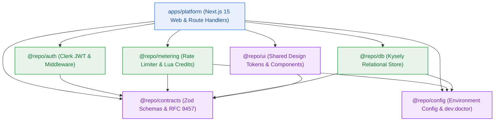

# Package & Repository Dependency Plan

> **Canonical Package Architecture, Dependency Matrices & Workspace Topology**  
> *Authoritative layout for package dependencies, internal module boundaries, and monorepo workspace hierarchies. Commissioned by `architect-agent` (Stage 3 Owner) and stewarded by `code-maintenance-specialist`.*



---

## 1. Repository Layout & Module Boundaries

- **Repository Topology:** Single Monorepo (Turborepo 2.x + Bun 1.1+ workspaces).
- **Two-Floor Architecture:**
  - **First Floor (Packages / Core Libraries):** Self-contained, single-responsibility modules living under `packages/*`. Zero dependencies on presentation frameworks or Next.js internals (`next/server`).
  - **Second Floor (Applications):** Deployable runtimes living under `apps/*` consuming first-floor packages.
- **Dependency Invariant:** Dependency arrows point strictly inward. Domain and contracts packages have zero dependencies on applications or database drivers. Circular dependencies are strictly forbidden.

```text
contextual/
├── package.json               # Root workspace manifest with Turborepo scripts
├── turbo.json                 # Pipeline configuration (build, test, lint, typecheck)
├── bunfig.toml                # Bun package manager configuration
├── infra/
│   └── compose.yaml           # Local container stack (PostgreSQL 16, Redis 7)
├── packages/
│   ├── config/                # Environment validation, tsconfigs, and dev:doctor
│   ├── contracts/             # Zod DTOs, OpenAPI types, RFC 9457 error catalogue
│   ├── db/                    # Kysely typed database client, schemas, migrations
│   ├── ui/                    # Design tokens, typography, glassmorphism components
│   ├── auth/                  # Clerk JWT verification, TenantContext, middleware
│   └── metering/              # Rate limiter, Lua credit ledger, daily reset cron
├── apps/
│   └── platform/              # Next.js 15 App Router platform application
└── tests/                     # Monorepo layout, package exports, and doctor suites
```

---

## 2. Package Dependency Matrix

| Package Name | Scope / Path | Direct External Dependencies | Internal Workspace Dependencies | License | Pinning Policy |
|---|---|---|---|---|---|
| **`@repo/config`** | `packages/config` | `zod@^3.23.8`, `dotenv@^16.4.5` | None | MIT | Exact / Caret |
| **`@repo/contracts`**| `packages/contracts`| `zod@^3.23.8` | None | MIT | Exact / Caret |
| **`@repo/db`** | `packages/db` | `kysely@^0.27.4`, `pg@^8.12.0`, `@types/pg` | `@repo/config`, `@repo/contracts` | MIT | Exact / Caret |
| **`@repo/ui`** | `packages/ui` | None (pure CSS/TS token interfaces) | `@repo/contracts` | MIT | Exact / Caret |
| **`@repo/auth`** | `packages/auth` | `@clerk/backend@^1.15.0` | `@repo/contracts` | MIT | Exact / Caret |
| **`@repo/metering`** | `packages/metering` | `@upstash/redis@^1.34.3`, `ioredis@^5.4.1` | `@repo/config`, `@repo/contracts` | MIT | Exact / Caret |
| **`apps/platform`** | `apps/platform` | `next@^15.0.0`, `react@^19.0.0`, `@clerk/nextjs` | `@repo/auth`, `@repo/metering`, `@repo/db`, `@repo/contracts`, `@repo/ui`, `@repo/config` | Proprietary | Workspace Protocol (`workspace:*`) |

---

## 3. Dependency Direction & Hygiene Rules

1. **Explicit Entry Points:** Every package exposes a root `src/index.ts` declaring public API symbols via package manifest `exports`. Deep-importing internal source files across package boundaries (e.g., `@repo/db/src/internal/pool.ts`) is blocked.
2. **Lockfile Inviolability:** CI pipelines enforce `--frozen-lockfile` (Bun). Unvetted or opportunistic dependency upgrades are prohibited.
3. **Strict Type Imports:** All cross-package type references use `import type { ... }` to guarantee zero runtime baggage and avoid circular imports.
4. **Zero Heavy Binary ORMs:** `@repo/db` uses lightweight Kysely with plain SQL drivers; heavy binary query engines (Prisma, TypeORM) are prohibited to prevent cold-start bloat on Vercel Hobby serverless functions.
5. **Two-Floor Separation:** First-floor packages (`packages/*`) must never import Next.js server packages (`next/server`, `next/navigation`). Web transport concerns remain strictly on the second floor (`apps/platform`).
