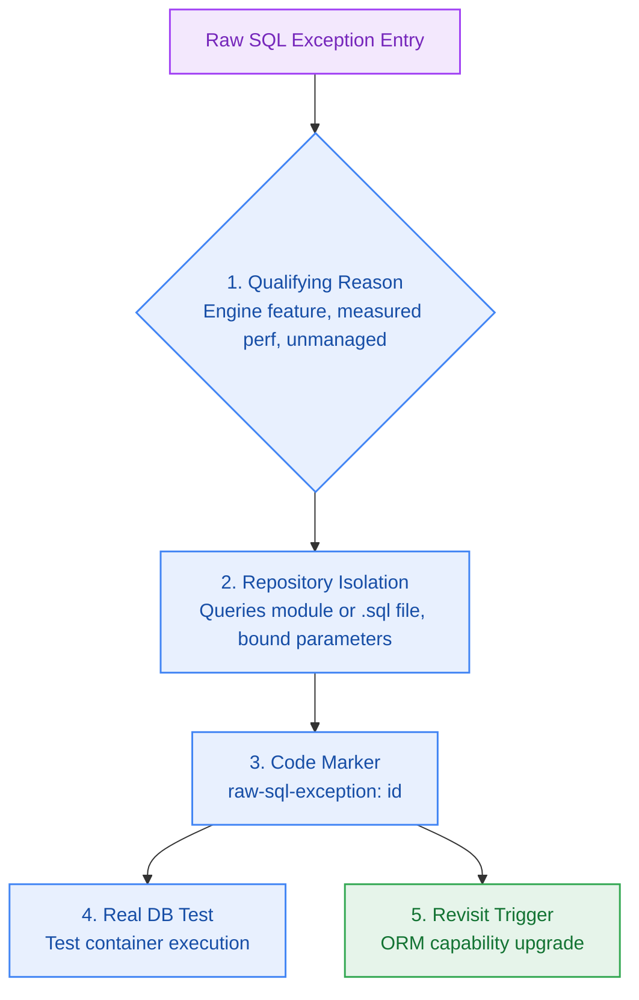

# Raw SQL Exception Register

> **Canonical Register** for tracking, justifying, and governing application data access that intentionally bypasses the project's approved ORM or typed data-access layer (Kysely). Every entry must correspond to an inline code marker comment (`raw-sql-exception: <register-id>`), provide qualifying technical justification, verify safety against real database fixtures, and define concrete revisit criteria.  
> *Stewarded by `data-architect` and governed by `architect-agent`.*

---

## 1. Exception Summary Matrix

| Register ID | Source Location | Operation / Purpose | Justification Category | Target Engine | Real DB Test | Owner | Revisit Condition |
|---|---|---|---|---|---|---|---|
| *(None in M1)* | — | — | — | PostgreSQL 16 | — | `data-architect` | — |

---

## 2. Milestone M1 Assessment & Exception Policy

### Current Register Status: Zero Exceptions (0)
For Milestone M1 (Developer Golden Path & Core Authentication):
1. **100% Typed Coverage:** All database schema definitions, migrations, and CRUD operations for `users`, `conversation_threads`, `conversation_messages`, and `notebooks` are 100% expressible through standard typed Kysely query builders.
2. **Prohibited Bare Clients:** No raw `pg.Client.query()` calls without Kysely typing are permitted in the codebase.
3. **Parameterization Assurance:** All dynamic values are passed strictly as bound parameters through Kysely's expression builder, preventing SQL injection vulnerabilities.
4. **Future Evaluation:** If complex vector similarity queries or advanced CTEs in Milestone M3/M5 require raw SQL, they must be registered in this document with qualifying justification and a containerized test verification before implementation.
