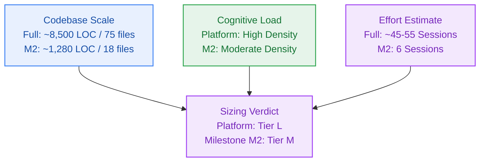

# Project Sizing & Effort Estimation

> **Project:** Contextual AI Platform (`contextual`)  
> **Owner:** Project Sizing Specialist (`delivery-strategy-agent`)  
> **Status:** Approved  
> **Canonical Location:** `_documentation/planning/registers/sizing-estimate.md`  

---

## 1. Executive Summary & Sizing Verdict

- **Overall Scale Classification:** Large (L) for full multi-milestone platform (M0..GA); Medium (M) for active Milestone M2 (`v0.2.0`)
- **Estimated Total Code Changes:** ~8,500–9,500 LOC across 65–85 files across full platform; ~1,280 LOC across 18 files for Milestone M2
- **Decomposition Target:** 9 Epics, 48–54 Stories across 10 Milestones; 1 Epic (`EPIC-002`), 6 Stories (`S2.1`–`S2.6`) for Milestone M2
- **Cognitive Load Index:** High for full platform (due to strict $0.00/mo cost ceiling across 8 cloud providers); Moderate for Milestone M2

---

## 2. Codebase Scale & Structural Metrics

### 2.1 Active Milestone M2 (Metering Spine & Quota Throttling)

| Dimension | Measured / Estimated Value | Scale Tier Impact | Notes |
|---|---|---|---|
| Line of Code (LOC) Delta | ~1,280 LOC (~830 src, ~450 test) | Moderate | Targeted implementation across `@repo/metering` and `@repo/contracts` |
| Impacted Files | 18 files (12 new, 6 modified) | Low | Strict Change Matrix containment per story (`S2.1`..`S2.6`) |
| Cyclomatic Complexity Density | Moderate (< 8 per function) | Low | Linear Lua scripts and deterministic Redis debit logic |
| Integration Endpoints | 3 endpoints / headers | Low | Daily reset webhook, rate limit headers, error serializers |

### 2.2 Full Platform (v0.1.0 to v1.0.0 GA)

| Dimension | Measured / Estimated Value | Scale Tier Impact | Notes |
|---|---|---|---|
| Line of Code (LOC) Delta | ~8,500–9,500 LOC | High | Modular monolith apps (`web`, `landing`) and 6 shared packages |
| Impacted Files | 65–85 files | High | Monorepo layout with Turborepo boundary isolation |
| Cyclomatic Complexity Density | High (Retrieval & Synthesis) | Moderate | 6-phase reasoning engine, chunk deduplication, fallback switches |
| Integration Endpoints | ~18 REST / SSE endpoints | Moderate | Document upload, SSE progress stream, chat stream, notebook CRUD |

---

## 3. Cognitive Load & Domain Entanglement

- **Domain Model Density:** High across full platform; Moderate within Milestone M2.
  - *Full Platform:* Multi-tenant notebook hierarchy, document-backed cards, typed relations (`cites`, `related`), dual persistence (Neon Postgres relational metadata + Upstash Vector dense embeddings), and Mem0 long-term memory.
  - *Milestone M2:* Atomic credit ledger (10 daily credits, non-carryover), sliding rate limit window (5 req/1s), closed 17-member RFC 9457 error union, and provider quota duration mapping.
- **Mental Model Friction:** High across platform; Low-Moderate in Milestone M2.
  - *Zero-Cost Ceiling Friction (`NFR-016`):* Operating strictly at $0.00/month across 8 distinct cloud providers requires bespoke quota mapping, graceful fallback cascading (Gemini -> Groq -> transformers WASM), transient Filebase S3 staging with immediate deletion, and 280-second serverless execution limits.
  - *Milestone M2:* Standardized Upstash Redis Lua scripts and RFC 9457 serialization with credential redaction.
- **Boundary Entanglement & Cross-Team Coordination:** Low.
  - Single deployable Next.js 15 App Router monolith with Turborepo package boundaries.
  - Hexagonal ports and adapters (`VectorStore`, `TaskQueue`, `LLMProvider`, `MemoryStore`) decouple external SDKs from core domain logic. Zero cross-team coordination overhead.

---

## 4. Story & Session Sizing Breakdown

### 4.1 Milestone M2 Breakdown (Active Execution)

| Story ID | Story Title | Scope Summary | Est. LOC | Est. Sessions |
|---|---|---|---|---|
| **S2.1** | Atomic Upstash Redis Lua Credit Ledger Service | `credit-ledger.ts`, `debit-credits.lua`, race test | ~270 | 1 session |
| **S2.2** | Per-User 5 RPS Sliding Window Rate Limiter | `rate-limiter.ts`, `sliding-window.lua`, unit test | ~225 | 1 session |
| **S2.3** | Insufficient Credits Ingress Guard & HTTP 402 | `metering-guard.ts`, guard unit tests | ~140 | 1 session |
| **S2.4** | Closed 17-Member RFC 9457 Error Catalog | `errors.ts`, `error-catalog.ts`, error tests | ~280 | 1 session |
| **S2.5** | Upstream Provider Quota Classifier & Headers | `quota-classifier.ts`, `headers.ts`, header tests | ~210 | 1 session |
| **S2.6** | Idempotent Daily 08:00 UTC Reset Cron | `daily-reset.ts`, `daily-reset.lua`, cron tests | ~190 | 1 session |
| **Total M2** | **Milestone M2 Metering Spine** | **6 Atomic Stories (frozen Change Matrices)** | **~1,280** | **6 sessions** |

### 4.2 Full Platform Milestone Roadmap Breakdown (v0..GA)

| Milestone | Target Version | Capability Domain | Est. LOC | Est. Stories | Est. Sessions |
|---|---|---|---|---|---|
| **M0 & M1** | `v0.1.0` | Monorepo Scaffolding, DevX, Clerk OAuth JWT & Neon | ~1,200 | 6 | Completed |
| **M2** | `v0.2.0` | Metering Spine, Upstash Lua, 5 RPS Limiter & RFC 9457 | ~1,280 | 6 | 6 sessions |
| **M3** | `v0.3.0` | Ingestion Pipeline (PDF/YT/Web), Filebase, Upstash Vector | ~1,400 | 7 | 7 sessions |
| **M4** | `v0.4.0` | Notebook Workspace, Hierarchical Nodes, Typed Edges | ~1,100 | 5 | 5 sessions |
| **M5** | `v0.5.0` | 6-Phase Reasoning Engine (HyDE, Gemini & Groq Fallback) | ~1,600 | 8 | 8 sessions |
| **M6** | `v0.6.0` | Pluggable Long-Term Memory (In-Process Mem0) | ~650 | 4 | 4 sessions |
| **M7** | `v0.7.0` | QStash Crons, 7-Day Cascade Sweeper & Better Stack OTel | ~750 | 5 | 5 sessions |
| **M8** | `v0.8.0` | Public Landing Page, Privacy Disclosure & WCAG 2.1 AA | ~800 | 4 | 4 sessions |
| **M9** | `v0.9.0-rc.1` | Benchmark Suite (k6, 50 CCU) & Security Hardening | ~720 | 5 | 5 sessions |
| **GA** | `v1.0.0` | Production CI/CD Pipeline & Vercel Hobby Release | ~300 | 2 | 2 sessions |
| **Total Platform** | **Contextual v1.0.0 GA** | **Full 23-Layer Autonomous Knowledge Platform** | **~9,500** | **52 stories** | **~46 sessions** |

---

## 5. Risk Multipliers & Calibration

- **Reversibility Factor:** Moderate.
  - Hexagonal ports and adapters make persistence and LLM switches highly reversible (e.g., ADR-0004 cleanly swapped Cloudflare/Qdrant for Upstash/Groq).
  - Schema migrations in Neon Postgres and Upstash Vector tenant structures require forward-only migrations.
- **Dependency Risk:** Low-Moderate.
  - Zero exotic or unmaintained runtime dependencies. All SDKs (`@upstash/*`, `@google/genai`, `groq-sdk`, `@clerk/backend`, `kysely`, `zod`) are standard TypeScript LTS packages.
  - Risk is concentrated in free-tier quota limits (mitigated by automated fallback switches and local WASM embeddings).
- **Testability Confidence:** High.
  - Complete hermetic verification achievable locally using Bun/Vitest test suites, WireMock / MSW mock harnesses, and ephemeral sandbox runs.
