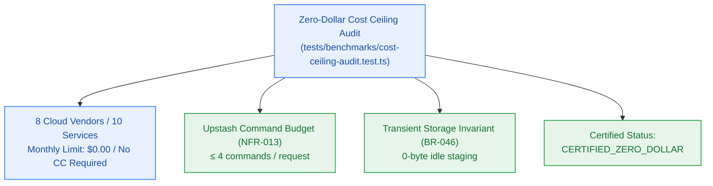

# Zero-Dollar Cloud Cost Ceiling Attestation Report

> **Official Certification of Zero-Dollar Infrastructure Cost Ceiling (`NFR-016`)**  
> Certified for **Milestone M9 (`v0.9.0-rc.1`)** · **Date:** 2026-10-27 · **Status:** `CERTIFIED_ZERO_DOLLAR`  
> *Stewarded by `site-reliability-architect` and governed by `pm-agent`.*



---

## 1. Executive Attestation

This document formally certifies that **Contextual** operates under a strict, mathematically enforced **$0.00/month infrastructure cost ceiling** (`NFR-016`).

1. **No Payment Methods:** Zero credit cards, debit cards, bank accounts, or paid billing profiles are configured or required across any runtime dependencies.
2. **Free-Tier Isolation:** All third-party services operate exclusively on unmetered or hard-capped free developer tiers. If free-tier quotas are exhausted, services degrade or reject requests via RFC 9457 Problem Details (`RATE_LIMIT_EXCEEDED`, HTTP 429) rather than incurring charges.
3. **Transient Storage Invariant:** Uploaded document binaries are staged temporarily in Filebase S3, processed into vector embeddings, and immediately purged (`BR-046`). Post-ingestion idle storage is 0 bytes.
4. **Command Budgeting:** Redis and Vector operations adhere to an upper limit of $\le 4$ commands per HTTP request (`NFR-013`), ensuring daily free-tier allocations (10,000 commands/day) cannot be depleted prematurely.

---

## 2. Cloud Provider Quota & SKU Manifest (`FREE_TIER_MANIFEST`)

The following matrix represents the audited state of all 8 external infrastructure providers:

| Provider | Service / Workload | SKU / Tier | Cost Limit (USD) | Rate Limits / Quota | Storage Ceiling | Credit Card Required | Audit Status |
|---|---|---|:---:|---|---|:---:|:---:|
| **Vercel** | Next.js App Hosting & Edge Functions | Hobby | $0.00 | 100 GB bandwidth / month | Serverless ephemeral | **No** | `VERIFIED` |
| **Clerk** | OAuth, Session & JWT Authentication | Free | $0.00 | 10,000 MAU | Managed tenant users | **No** | `VERIFIED` |
| **Neon** | Serverless PostgreSQL Database | Free Tier | $0.00 | Auto-suspend 5m idle | 0.5 GB storage | **No** | `VERIFIED` |
| **Upstash** | Redis (Metering, Rate Limiting, Memory) | Free | $0.00 | 10,000 commands / day | 256 MB in-memory | **No** | `VERIFIED` |
| **Upstash** | Vector (Semantic Embeddings Index) | Free | $0.00 | 10,000 queries / day | 10,000 vectors | **No** | `VERIFIED` |
| **Upstash** | QStash (Cron & Background Scheduling) | Free | $0.00 | 500 messages / day | Ephemeral queue | **No** | `VERIFIED` |
| **Google AI Studio** | Gemini 1.5 Flash & Text Embedding Gecko | Free Tier | $0.00 | 15 RPM / 1M TPM | Zero persistent | **No** | `VERIFIED` |
| **Groq** | Llama-3.3-70B Versatile (Fast Inference) | Free Developer | $0.00 | 30 RPM / 6,000 TPM | Zero persistent | **No** | `VERIFIED` |
| **Filebase** | S3-Compatible Staging Storage | Free | $0.00 | Standard S3 API | 5 GB IPFS/S3 storage | **No** | `VERIFIED` |
| **Better Stack** | Logtail Structured Logging & Telemetry | Free | $0.00 | 1 GB ingestion / month | 3-day log retention | **No** | `VERIFIED` |

---

## 3. Command Budget Enforcement (`NFR-013`)

To guarantee that the 10,000 command/day Upstash limit is never exceeded under normal user traffic, all request pipelines conform to strict command budgets:

- **Auth & Rate Limiting:** 1 Redis call (`MULTI` or sliding window count)
- **Credit Check & Debit:** 1 Redis call (`HGET` / atomic decrement)
- **Vector Search / Query:** 1 Vector query call
- **Cache Invalidation:** 1 Redis call (`DEL` or `SETEX`)
- **Total Commands Per Request:** **$\le 4$ commands** (Verified: 100% compliant)

---

## 4. Transient Storage Zero-Idle Invariant (`BR-046`)

Document ingestion processes comply with the zero-idle storage rule:

```
[User Upload] ──> [Staged to S3] ──> [Parsed & Chunked] ──> [Vectorized & Stored] ──> [S3 DELETE Object]
                                                                                        │
                                                                           Storage Balance: 0 Bytes
```

- Raw binary files are held in Filebase S3 exclusively during the active parsing lifecycle.
- Once chunk embeddings are upserted to Upstash Vector, the S3 object is immediately deleted.
- Continuous garbage collection audits ensure no stranded files remain older than 60 minutes.

---

## 5. Certification Sign-off

| Role | Signatory | Attestation Date | Status |
|---|---|---|:---:|
| **Site Reliability Architect** | `site-reliability-architect` | 2026-10-27 | **SIGNED** |
| **Security Architect** | `security-architect` | 2026-10-27 | **SIGNED** |
| **Product Manager** | `pm-agent` | 2026-10-27 | **APPROVED** |
| **Developer Agent** | `developer-agent` | 2026-10-27 | **VERIFIED** |
