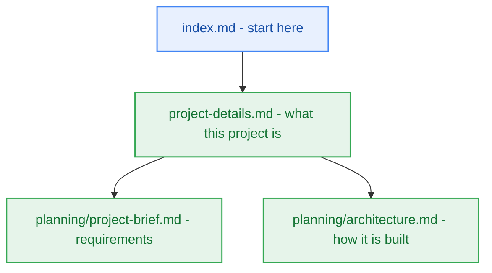

# Project Details

> Project overview, owned by `pm-agent`. Start every session at [index.md](index.md), the navigation hub; this file says what the project is.

## 1. Overview

- **Purpose:** {one paragraph, written by `pm-agent` once the project brief exists}
- **Users and stakeholders:** {who it is for}
- **Current milestone:** see [milestone-status.yaml](planning/milestones/milestone-status.yaml)

## 2. Workspace Layout

- **`_documentation/planning/`** — canonical documentation: `project-brief.md`, `prd.md`, `conventions.md`, `architecture.md` (arc42 §1–§12, with detail docs in `planning/architecture/`), `contracts/`, `decisions/`, `registers/`, `quality/`, `epics/`, `milestones/`.
- **`_documentation/logs/`** — records only (`party-mode/`, `handoff-documents/`, `research-artifacts/`); never a description of the current system.
- **`_documentation/system/`** — workflow state: [delivery-strategy.yaml](system/delivery-strategy.yaml), [workflow-context.yaml](system/workflow-context.yaml), ephemeral `task.yaml`.
- **`src/`** — product code.

## 3. Questionnaire

[questionnaire.yaml](planning/questionnaire.yaml) is the one file you edit: fill in `user_answer` and hand it back. The owning agent records the consequence in its own document with a `[Q-00N]` trace and clears the question.

## 4. Delivery Stages

Analyst → Product Manager → Architect → Developer → Deployment, each closing its checkpoint with evidence and a handoff whose `Documentation impact` lists every affected document.
