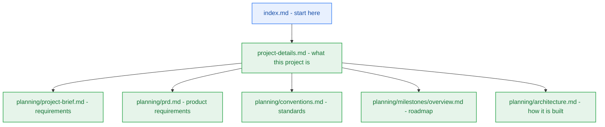

# Project Details

> Project overview, owned by `pm-agent`. Start every session at [index.md](index.md), the navigation hub; this file says what the project is.

## 1. Overview

- **Purpose:** Contextual AI Platform (`contextual`) is an enterprise-grade conversational knowledge retrieval platform operating strictly within a $0.00/month infrastructure ceiling. It ingests heterogeneous documents (PDFs, YouTube transcripts, web articles) into personal notebook workspaces and executes a 6-phase reasoning pipeline with query decomposition, HyDE passages, and grounded citations.
- **Users and stakeholders:** Knowledge workers, researchers, software engineers, and students who require grounded multi-document question-answering without incurring monthly cloud fees.
- **Current milestone:** M0: Workspace Foundation & Scaffolding (`v0.1.0-alpha.1`) — Planned / Not Started. (Reconciled: previous records falsely marked M0 & M1 as complete based on external project inferences; repository is currently a clean workspace awaiting M0 scaffolding). See [milestone-status.yaml](planning/milestones/milestone-status.yaml) and [overview.md](planning/milestones/overview.md).
- **Canonical Specifications:**
  - [project-brief.md](planning/project-brief.md) — 42 FRs, 32 NFRs, 48 Business Rules, §12 Glossary
  - [prd.md](planning/prd.md) — Product Requirements Document (10 sections, FR-to-Epic mapping)
  - [conventions.md](planning/conventions.md) — Engineering standards, SemVer policy v0 to v1, RFC 9457 error catalogue
  - [milestones/overview.md](planning/milestones/overview.md) — Release hierarchy (M0..M9/GA), 7-level testing strategy, quality gates
  - [architecture.md](planning/architecture.md) — arc42 architecture narrative (§1–§12) & [04-tech-stack.md](planning/architecture/04-tech-stack.md)
  - [contracts/](planning/contracts/) — [component-catalog.yaml](planning/contracts/component-catalog.yaml) & [api-contract.openapi.yaml](planning/contracts/api-contract.openapi.yaml)
  - [decisions/adr-0004](planning/decisions/adr-0004-unified-upstash-serverless-architecture.md) — Unified Upstash Serverless Architecture & Groq Fallback

## 2. Workspace Layout

- **`_documentation/planning/`** — canonical documentation: `project-brief.md`, `prd.md`, `conventions.md`, `architecture.md` (arc42 §1–§12), `contracts/`, `decisions/`, `registers/`, `quality/`, `epics/`, `milestones/`.
- **`_documentation/logs/`** — records only (`party-mode/`, `handoff-documents/`, `research-artifacts/`); never a description of the current system.
- **`_documentation/system/`** — workflow state: [delivery-strategy.yaml](system/delivery-strategy.yaml), [workflow-context.yaml](system/workflow-context.yaml), ephemeral `task.yaml`.
- **`src/`** or monorepo `apps/`, `packages/` — product code.

## 3. Questionnaire

[questionnaire.yaml](planning/questionnaire.yaml) is the one file you edit: fill in `user_answer` and hand it back. The owning agent records the consequence in its own document with a `[Q-00N]` trace and clears the question.

## 4. Delivery Stages

Analyst → Product Manager → Architect → Developer → Deployment, each closing its checkpoint with evidence and a handoff whose `Documentation impact` lists every affected document.
